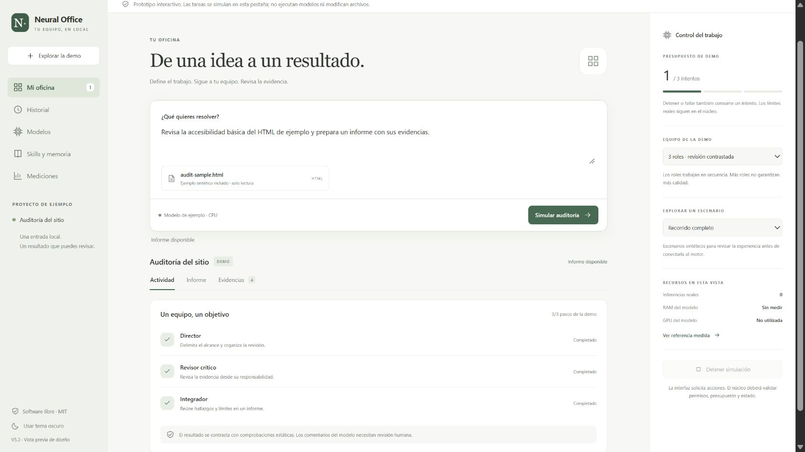

# Neural Office

**Tu oficina de agentes de IA, en tu máquina.**

Software gratuito y de código abierto bajo [MIT](LICENSE), con [apoyo voluntario](#apoya-el-proyecto) y las mismas funciones para todas las personas.

Hoy puedes revisar un HTML local con uno, tres o siete roles, consultar el informe y controlar cada intento. **V5.3 añade mediciones reproducibles y una vista previa interactiva de la nueva interfaz.** El piloto operativo sigue siendo Python/Tkinter para Windows; la interfaz nueva todavía simula las tareas.

[](https://github.com/ymkaddur/neural-office/actions/workflows/windows-tests.yml)
[](https://www.python.org/downloads/)
[](LICENSE)



Captura del **prototipo sin motor** con datos sintéticos. Puedes [abrir y explorar la demo](desktop/README.md), incluidos parada, errores y recuperación. El [piloto operativo anterior](docs/images/pilot-v5.2.1.jpg) conserva sus informes y controles; la integración del nuevo escritorio se prepara para V5.5.

## Empieza por un ejemplo

Necesitas **Windows, Python 3.12 con Tk y Ollama con un modelo local ya descargado**. Esta descarga contiene el código del piloto; el instalador autónomo es un hito futuro.

1. [Descarga la vista previa V5.3](https://github.com/ymkaddur/neural-office/archive/refs/tags/v5.3-preview.1.zip) y extrae la carpeta.
2. Abre `.\run.bat`. También puedes ejecutar `py -3.12 -B -m neural_office gui` desde esa carpeta.
3. Selecciona el modelo, pulsa **Usar ejemplo** y después **Autorizar y auditar**.
4. Consulta **Ver presupuesto** y **Ver último informe**. **Detener** solicita cancelar y espera la terminación comprobada.

El [HTML de ejemplo](examples/audit-sample.html) tiene cuatro hallazgos esperados: falta de idioma, título vacío, imagen sin `alt` y un control cuya etiqueta hay que revisar. No requiere descargar una web. Los comentarios generados pueden variar; las comprobaciones estáticas tienen un resultado contrastable.

El piloto admite HTML UTF-8 de hasta 256 KiB. Lee la entrada sin ejecutar sus scripts, seguir sus enlaces ni modificarla. El análisis cubre esas heurísticas, no una certificación de accesibilidad o seguridad.

## Lo que puedes controlar hoy

- **Roles:** uno, tres o siete, ejecutados en secuencia con un backend local propio.
- **Presupuesto:** tres intentos por proyecto; los fallos y cancelaciones cuentan. Es el límite deliberado de esta vista previa.
- **Parada y recuperación:** el árbol de procesos propio debe terminar antes de liberar el bloqueo.
- **Evidencia:** entradas capturadas, respuestas e informe guardados localmente, con verificación de las comprobaciones estáticas.
- **Continuidad:** respaldo y restauración con un testigo retenido, sin devolver intentos al cargar una copia antigua.
- **Historial:** conciliación explícita de fuentes V1/V4/Plus y ledgers compatibles; importar no activa proyectos ni concede autoridad.

Se admite una inferencia administrada por ledger y hasta dos proyectos activos. La conciliación bloquea discrepancias y esquemas no mapeados; no sustituye ni controla clientes externos como OpenCode. El [manual de continuidad y conciliación](docs/V5_2_1_OPERATIONS.md) explica el alcance, los comandos y la conservación del testigo.

**Si ya usabas V5.2:** cierra los controladores anteriores y ejecuta `.\run.bat protect` sobre tu estado existente antes de abrir la interfaz. No borres el estado para actualizar. Para un ledger explícito: `.\run.bat --state "D:\NeuralOfficeState\office.sqlite3" protect`.

## Estado de la entrega

| Capacidad | Estado |
| --- | --- |
| Piloto HTML, informes y cuotas persistentes | Verificado en pruebas y una ejecución local real de esta revisión |
| Conciliación histórica y restauración | Verificadas para los esquemas y límites documentados |
| Respuesta 401 intermitente del gateway histórico | Reproducida y corregida; diff y regresión publicados |
| Timeout histórico al arrancar Ollama | Causa pendiente; instrumentación por etapas verificada |
| Medición CPU, memoria del backend y comparación 1/3/7 | Seis intentos reales aceptados; calidad comparada y GPU pendientes |
| Nueva interfaz React/TypeScript | Prototipo interactivo probado; sin conexión al motor |
| Contrato de escritorio | Especificación y validador de mensajes probados; transporte pendiente |
| Memoria, skills aprendidas y tareas generales | Planificadas |
| Instalador autónomo y otros sistemas operativos | Planificados |

La [revisión forense V5.3](docs/V5_3_FORENSIC_REVIEW.md) enlaza resultados, regresiones y límites, y conserva la [revisión V5.2.1](docs/V5_2_1_FORENSIC_REVIEW.md). La [visión hasta V10](ROADMAP.md) sitúa optimización, interfaz, memoria y distribución en hitos comprobables.

## Optimización con una referencia real

| Roles en secuencia | Mediana total | Pico residente observado del backend¹ |
| --- | --- | --- |
| 1 | 28,80 s | 5,88 GiB |
| 3 | 57,39 s | 6,25 GiB |
| 7 | 109,46 s | 6,90 GiB |

Dos ensayos por perfil, una máquina, el HTML incluido y un modelo en CPU. ¹ Suma muestreada de memoria residente; puede contar páginas compartidas varias veces y excluye interfaz/controlador. Estas cifras no son requisitos mínimos ni una comparación de calidad. [Protocolo, entorno y recibos](docs/V5_3_MEASUREMENT_PROTOCOL.md).

La prioridad V5.4 es comparar contexto, carga, CPU/GPU y reutilización con evaluación de utilidad. La nueva interfaz llega conectada en V5.5. [Contrato de integración](docs/V5_3_DESKTOP_CONTRACT.md) · [revisión dirigida de vídeos](docs/V5_3_VIDEO_RESEARCH.md).

## Apoya el proyecto

Neural Office es gratuito y de código abierto. Puedes usar todas sus funciones disponibles sin pagar ni tener una cuenta de patrocinador. El apoyo es voluntario y ayuda a sostener el desarrollo, las pruebas, la documentación y la distribución.

Los límites técnicos de esta vista previa se aplican por igual a todo el mundo. Aportar no desbloquea funciones ni aumenta cuotas; tampoco concede acceso anticipado, prioridad de soporte o trabajo personalizado. Las novedades y la documentación del proyecto son públicas.

Puedes apoyar el proyecto a través de estas plataformas:

| Plataforma | Modalidad | Estado |
| --- | --- | --- |
| GitHub Sponsors | Aportaciones puntuales o mensuales | Pendiente de habilitación del perfil de cobro |
| [Patreon](https://www.patreon.com/Neural_office) | Apoyo mensual en euros | Página publicada |

**Niveles de apoyo en Patreon:**

| Nivel | Aportación base |
| --- | --- |
| Apoyo de 1 € | 1 €/mes |
| Apoyo de 3 € | 3 €/mes |
| Apoyo de 5 € | 5 €/mes |
| Apoyo de 10 € | 10 €/mes |

Todos los niveles tienen el mismo propósito: apoyar el proyecto, sin funciones ni contenido exclusivos. Elige el importe que te resulte cómodo; usar Neural Office sin aportar también está bien. Los importes indicados son los precios base; la plataforma mostrará el total aplicable antes de confirmar la suscripción.

El botón **Sponsor** de este repositorio enlaza a Patreon. GitHub Sponsors sigue pendiente de activación y configura sus niveles en [dólares estadounidenses](https://docs.github.com/en/sponsors/receiving-sponsorships-through-github-sponsors/setting-up-github-sponsors-for-your-personal-account#creating-sponsorship-tiers); sus importes se mostrarán por separado, sin prometer una equivalencia fija con los euros de Patreon.

También puedes ayudar probando la aplicación, comunicando errores reproducibles o mejorando la documentación. La gratuidad corresponde al software; el equipo, los modelos y cualquier servicio externo conservan sus propios requisitos, licencias y posibles costes.

## Desarrollo y contribuciones

```powershell
.\run.bat --version
py -3.12 -B -m unittest discover -s tests -v
.\run.bat models
.\run.bat status
```

La suite pública Python funciona sin modelos, credenciales ni historial privado: 125 pruebas en esta revisión. El [frontend](desktop/README.md) añade siete pruebas de estado y comprobación de tipos/build. [CONTRIBUTING.md](CONTRIBUTING.md) explica cómo aportar una reproducción pequeña, una corrección localizada o documentación. La [comparación de 91 README](docs/README_RESEARCH_91.md) documenta las decisiones de presentación.

## Datos y licencia

El piloto se comunica con Ollama por loopback y rechaza perfiles cloud. Guarda entradas, respuestas y estado en archivos locales **sin cifrado**; no publiques esa carpeta de datos. Descargar modelos y el comportamiento de otros clientes son flujos separados. No se promete privacidad absoluta de toda la máquina.

[MIT](LICENSE) para las aportaciones propias que el promotor pueda licenciar. Desarrollo asistido por IA bajo supervisión. CrewAI fue una base conceptual e histórica; no es una dependencia del núcleo publicado. No se incluyen runtimes, pesos, vídeos ni historiales privados. [LICENSING.md](LICENSING.md) y el [expediente de procedencia](docs/V5_2_PROVENANCE.md) delimitan los derechos de terceros y las cuestiones jurídicas abiertas.

Los contratos [V5.1](docs/V5_1_INTEGRATION_SPEC.md) y [V5.2](docs/V5_2_INTEGRATION_AND_ACCEPTANCE.md) se conservan como documentos fechados. V5.3 no modifica la política del piloto ni declara resuelto su timeout histórico. [Dependencias del frontend](docs/evidence/V5_3_COMPONENTS.json) y [avisos de terceros](desktop/THIRD_PARTY_NOTICES.md).
