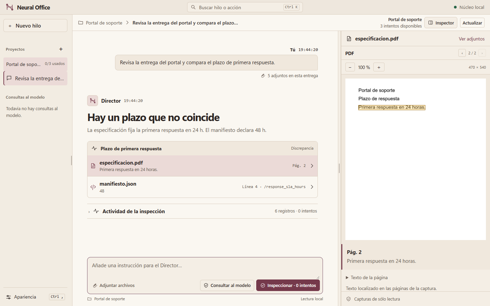

# Neural Office

**V5.30 · ejecución durable en Windows.** Desde la CLI se puede autorizar una revisión local de HTML, consultar cada salida y retomar el encargo después de un corte. La obtención de hallazgos, su verificación y la entrega dejan tres recibos vinculados a los mismos bytes. El protocolo reserva un intento de proyecto. La comprobación simple de HTML sigue siendo gratuita. La ingeniería de esta rama se concentra en el núcleo y el escritorio conserva la interfaz de V5.14. [Ejemplo ejecutable, pruebas de cortes y medidas de V5.30](docs/V5_30_LOCAL.md).

El Director conserva las decisiones del hilo y sus fuentes en la inspección multiformato. La orden `office-plan` describe la topología prevista del Director y seis especialistas. La conexión de esa topología con el modelo local corresponde a V5.40. [Inspección y referencia de Ollama de V5.20](docs/V5_20_LOCAL.md) · [Hoja de ruta](ROADMAP.md).

[](LICENSE)

La comprobación de V5.14 en Windows cubre el núcleo Python, el frontend en Edge y una consulta a Ollama. El Control de aplicaciones bloqueó un auxiliar de Rust antes de generar el ejecutable. Las capturas históricas que aparecen abajo pertenecen a V5.13. [Pruebas de V5.14 y límites de la entrega](docs/V5_14_LOCAL.md)

## Probar una entrega

El ejemplo contiene la especificación PDF de un portal, su manifiesto JSON, dos imágenes y un ZIP. Pulsa **Adjuntar archivos**, selecciona los cinco y elige **Inspeccionar · 0 intentos**. Abre el hallazgo para comparar la página del PDF que exige una respuesta en 24 horas con la línea del manifiesto que declara 48. Los archivos, el informe y los recibos se pueden volver a abrir por proyecto e hilo. [Ejemplo, puesta en marcha y verificación](docs/V5_13_POLISHED.md)

La consulta al modelo consume **un intento al autorizar la reserva**. Cada proyecto dispone de tres. El permiso identifica los fragmentos, el modelo y el saldo. Un fallo después de la reserva y una cancelación también consumen ese intento. Abre **Actividad del encargo** para seguir los hechos registrados.

En **Apariencia** puedes cambiar entre Arena, Azul noche y el tema del sistema. Los ajustes de densidad, tamaño de texto y contraste se aplican al hilo y al inspector.



[Vista del paquete en Azul noche](docs/images/v5.13-paquete.png) · [Mediciones de tipografía, contraste y recursos](docs/evidence/V5_13_RENDERER.json)

## Revisión de HTML

Desde el inspector, **Abrir revisión de HTML con roles** conserva el flujo de revisión estática y la consulta opcional con 1, 3 o 7 roles secuenciales. También puedes comprobar la muestra desde Python 3.12. [Alcance de las reglas](docs/HTML_REVIEW.md)

```powershell
py -3.12 -B -m neural_office check --root examples --file examples/audit-sample.html
```

Para ejecutar la aplicación necesitas Windows x64, WebView2, Python 3.12 y el código del mismo commit que el ejecutable de prueba. El lanzador prepara los lectores PDF e imagen. Ollama se utiliza al pedir comentarios del modelo. [Instalación y compilación](desktop/README.md) · [Coste, datos y recuperación](docs/README.md)

## Hacia la oficina local V6.0

La beta prevé tres rondas autónomas, modelos locales propios o importados, revisión de una URL, memoria por proyecto y skills con historial y revocación. La hoja de ruta define las pruebas de autoridad, utilidad, recuperación y el techo de 1,50× de recursos frente a una consulta real de Ollama en PowerShell. [Implementación y criterios por versión](ROADMAP.md).

En seis tareas con un modelo local pequeño, el Director y la revisión de tres roles dieron las mismas ubicaciones que las reglas. Sus comentarios no añadieron acciones útiles según la rúbrica fijada. [Comparación y costes](docs/V5_7_REVIEW.md).

## Contribuir

Prueba un caso pequeño, describe qué esperabas y qué ocurrió. [Cómo contribuir](CONTRIBUTING.md) · [Pruebas y documentación técnica](docs/README.md) · [Comunicar un problema de seguridad](SECURITY.md).

Los archivos, respuestas y registros se guardan localmente sin cifrar. No adjuntes tu carpeta de estado a un issue. [Frontera de confianza](SECURITY.md) · [Licencias y procedencia](LICENSING.md).

## Apoyo voluntario

[Patreon](https://www.patreon.com/Neural_office): 1 €, 3 €, 5 € o 10 €/mes, sin funciones exclusivas. GitHub Sponsors sigue pendiente de activación. [Detalles del apoyo](docs/SUPPORT.md). Usar Neural Office es gratis.
