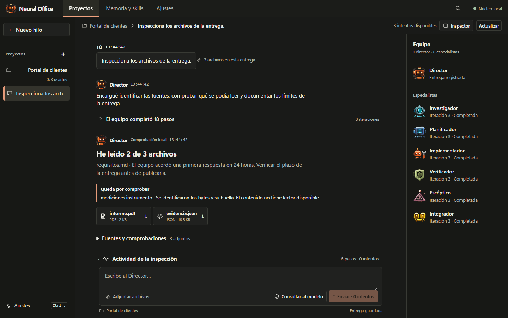

# Neural Office

**V5.35 · oficina local de archivos para Windows.** Adjunta documentos, datos, imágenes o archivos de una aplicación propia y escribe qué necesitas averiguar. El Director reúne la entrega, las fuentes y las preguntas pendientes en un hilo. Puedes abrir las tres rondas de cada uno de los seis especialistas y descargar el informe y la evidencia. [Funcionamiento y pruebas de V5.35](docs/V5_35_LOCAL.md)

En Windows se verificaron el núcleo y la interfaz de producción en Edge. El ejecutable Tauri final compiló. Control de aplicaciones bloqueó su arranque con el error 4551. La validación de ese ejecutable queda pendiente.

## Probar un encargo

1. Abre el escritorio, crea un proyecto y usa **Adjuntar archivos** para elegir tus fuentes en Windows.
2. Escribe **Inspecciona los archivos** para obtener un inventario con los datos recuperados, o **Busca «24 horas» en los archivos** para obtener una cita con su página o línea cuando exista. Ejecuta la inspección local. Consume cero intentos.
3. Lee la entrega del Director. Abre un especialista, cambia de iteración y consulta la instrucción recibida, la operación realizada y su resultado. Desde la entrega puedes descargar **informe.pdf** y **evidencia.json**.
4. En **Memoria y skills**, guarda una nota o propone una instrucción a partir de esa entrega. Puedes revisar su historial, aceptar el cambio e insertarlo en el borrador de un nuevo encargo. **Ajustes** controla el tema claro, oscuro o del sistema, el tamaño del texto y el movimiento.

El selector admite cualquier extensión, incluidos archivos sin extensión. La lectura depende de la estructura y del tamaño. Un binario desconocido conserva tamaño y huella. El trabajo de las tres rondas se ejecuta con lectores y reglas locales. La consulta opcional a Ollama conserva su autorización y su presupuesto propio. [Diferencias entre inspección, consulta e inferencia autónoma](docs/V5_35_LOCAL.md)

Para compilar y abrir el escritorio se necesita Windows x64 con WebView2 y Python 3.12. El lanzador usa los lectores locales fijados para PDF e imágenes. [Instalación y compilación](desktop/README.md) · [Licencia MIT](LICENSE) · [Pruebas anteriores](docs/V5_30_LOCAL.md)

## Hacia la oficina local V6.0

La beta prevé tres rondas autónomas, modelos locales propios o importados, revisión de una URL, memoria por proyecto y skills con historial y revocación. La hoja de ruta define las pruebas de autoridad, utilidad, recuperación y el techo de 1,50× de recursos frente a una consulta real de Ollama en PowerShell. [Implementación y criterios por versión](ROADMAP.md).

En seis tareas con un modelo local pequeño, el Director y la revisión de tres roles dieron las mismas ubicaciones que las reglas. Sus comentarios no añadieron acciones útiles según la rúbrica fijada. [Comparación y costes](docs/V5_7_REVIEW.md).

## Contribuir

Prueba un caso pequeño, describe qué esperabas y qué ocurrió. [Cómo contribuir](CONTRIBUTING.md) · [Pruebas y documentación técnica](docs/README.md) · [Comunicar un problema de seguridad](SECURITY.md).

Los archivos, respuestas y registros se guardan localmente sin cifrar. No adjuntes tu carpeta de estado a un issue. [Frontera de confianza](SECURITY.md) · [Licencias y procedencia](LICENSING.md).

## Apoyo voluntario

[Patreon](https://www.patreon.com/Neural_office): 1 €, 3 €, 5 € o 10 €/mes, sin funciones exclusivas. GitHub Sponsors sigue pendiente de activación. [Detalles del apoyo](docs/SUPPORT.md). Usar Neural Office es gratis.
