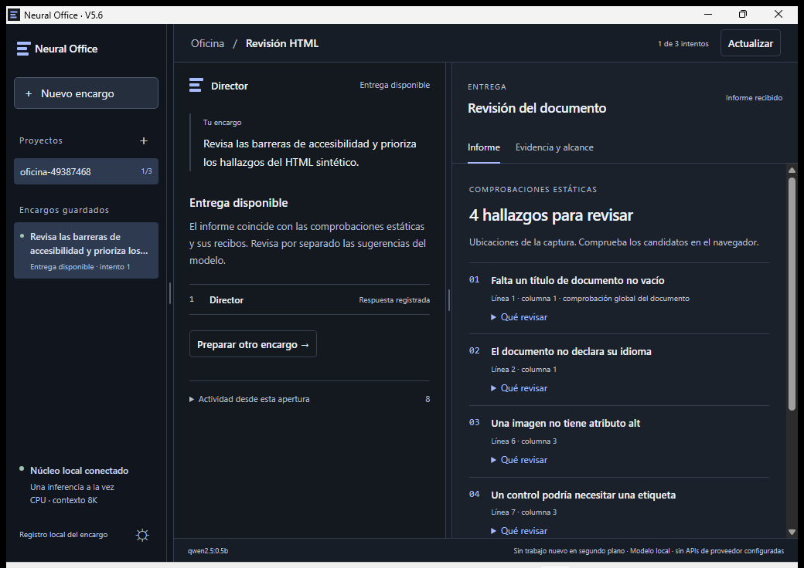

# Neural Office

**Revisa en local. Decide con evidencia.**

Un espacio de trabajo para encargar una revisión, seguir su ejecución y recuperar la entrega. Gratis y open source, con las mismas funciones para todo el mundo.

**V5.6 · alpha para Windows.** Hoy revisa archivos HTML: señala ubicaciones y próximos pasos, permite consultar un modelo local y conserva los informes de cada encargo.

[](https://github.com/ymkaddur/neural-office/actions/workflows/windows-tests.yml)
[](LICENSE)



V5.6 en Windows, con el ejemplo incluido y un modelo local real. [Cambios y verificación](docs/V5_6_REVIEW.md).

## Qué puedes hacer

- **Revisar un HTML:** idioma, título, alternativas de imágenes y posibles controles sin etiqueta, con ubicación y una acción sugerida.
- **Pedir comentarios al Director:** elige tu modelo instalado en Ollama y autoriza el alcance antes de empezar.
- **Controlar el trabajo:** consulta llamadas, detén la ejecución y vuelve a abrir el informe sin repetirla.
- **Conservar contexto:** consulta el historial y vuelve al borrador durante la misma apertura. La fuente original permanece intacta.

Los hallazgos estáticos y los comentarios del modelo se presentan por separado. El producto lee archivos; no edita repositorios ni ejecuta herramientas propuestas por un modelo.

## Probarlo

**Sin modelo:** con Windows y Python 3.12, [descarga el código](https://github.com/ymkaddur/neural-office/archive/refs/heads/main.zip), extrae la carpeta y ejecuta desde ella:

```powershell
py -3.12 -B -m neural_office check --root examples --file examples/audit-sample.html
```

Devuelve cuatro hallazgos en JSON y la huella del archivo. No inicia Ollama, crea estado ni consume intentos. [Ejemplos y alcance](docs/HTML_REVIEW.md).

**En el escritorio:** sigue la [guía de compilación y uso](desktop/README.md). Necesita Windows x64, Python 3.12, WebView2 y Ollama; compilar requiere Node, Rust y las herramientas de Windows. Todavía se distribuye como código para desarrollo, sin instalador firmado.

1. Escribe el encargo y selecciona un HTML local.
2. Elige el modelo, revisa el alcance y autoriza un intento.
3. Comprueba la entrega y sus ubicaciones. El historial permite volver a leerla.

El perfil inicial usa un rol en CPU. Cada proyecto dispone de tres intentos; fallos y cancelaciones cuentan. [Uso, datos y recuperación](docs/README.md).

## Hacia V6

Primero, utilidad demostrada y una experiencia consistente. Después, memoria inspeccionable, optimización con la misma calidad y distribución sencilla. [Hoja de ruta y criterios de aceptación](ROADMAP.md).

La referencia estática funciona sin inferencias. Los perfiles de más roles tendrán que demostrar una mejora frente a ella antes de convertirse en la opción recomendada.

## Contribuir

Prueba un caso pequeño, describe qué esperabas y qué ocurrió. [Cómo contribuir](CONTRIBUTING.md) · [Pruebas y documentación técnica](docs/README.md) · [Comunicar un problema de seguridad](SECURITY.md).

Los archivos, respuestas y registros se guardan localmente sin cifrar. No adjuntes tu carpeta de estado a un issue. [Frontera de confianza](SECURITY.md) · [Licencias y procedencia](LICENSING.md).

## Apoyo voluntario

[Patreon](https://www.patreon.com/Neural_office): 1 €, 3 €, 5 € o 10 €/mes, sin funciones exclusivas. GitHub Sponsors sigue pendiente de activación. [Detalles del apoyo](docs/SUPPORT.md). Usar Neural Office es gratis.
