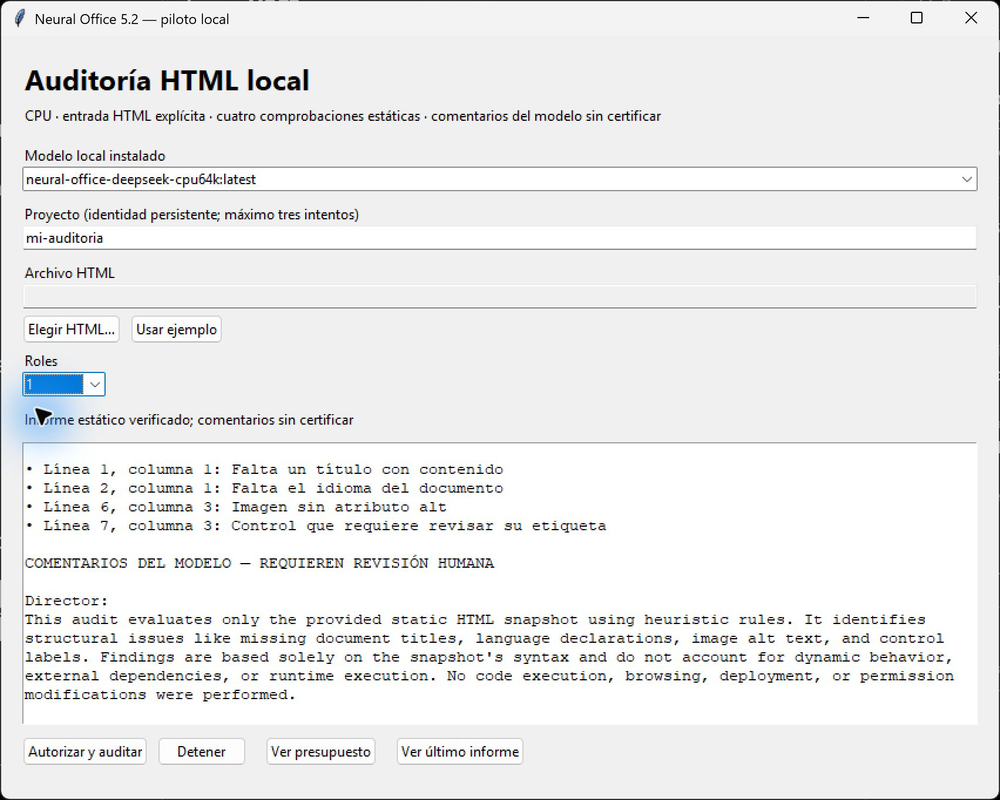

# Neural Office

**Tu oficina de agentes de IA, en tu máquina.**

Hoy puedes revisar un HTML local con uno, tres o siete roles, consultar el informe y controlar cada intento. La visión es una oficina con memoria, skills y tareas encadenadas; **V5.2.1 es una vista previa para Windows**.

[](https://github.com/ymkaddur/neural-office/actions/workflows/windows-tests.yml)
[](https://www.python.org/downloads/)
[](LICENSE)



Captura del piloto con el ejemplo sintético incluido. El informe se vuelve a abrir desde el estado guardado; los comentarios del modelo requieren revisión humana.

## Empieza por un ejemplo

Necesitas **Windows, Python 3.12 con Tk y Ollama con un modelo local ya descargado**. Esta descarga contiene el código del piloto; el instalador autónomo es un hito futuro.

1. [Descarga la vista previa](https://github.com/ymkaddur/neural-office/archive/refs/tags/v5.2.1-preview.1.zip) y extrae la carpeta.
2. Abre `.\run.bat`. También puedes ejecutar `py -3.12 -B -m neural_office gui` desde esa carpeta.
3. Selecciona el modelo, pulsa **Usar ejemplo** y después **Autorizar y auditar**.
4. Consulta **Ver presupuesto** y **Ver último informe**. **Detener** solicita cancelar y espera la terminación comprobada.

El [HTML de ejemplo](examples/audit-sample.html) tiene cuatro hallazgos esperados: falta de idioma, título vacío, imagen sin `alt` y un control cuya etiqueta hay que revisar. No requiere descargar una web. Los comentarios generados pueden variar; las comprobaciones estáticas tienen un resultado contrastable.

El piloto admite HTML UTF-8 de hasta 256 KiB. Lee la entrada sin ejecutar sus scripts, seguir sus enlaces ni modificarla. El análisis cubre esas heurísticas, no una certificación de accesibilidad o seguridad.

## Lo que puedes controlar hoy

- **Roles:** uno, tres o siete, ejecutados en secuencia con un backend local propio.
- **Presupuesto:** tres intentos por proyecto; los fallos y cancelaciones cuentan. Es el límite deliberado de esta vista previa.
- **Parada y recuperación:** el árbol de procesos propio debe terminar antes de liberar el bloqueo.
- **Evidencia:** entradas capturadas, respuestas e informe guardados localmente, con verificación de las comprobaciones estáticas.
- **Continuidad:** respaldo y restauración con un testigo retenido, sin devolver intentos al cargar una copia antigua.
- **Historial:** conciliación explícita de fuentes V1/V4/Plus y ledgers compatibles; importar no activa proyectos ni concede autoridad.

Se admite una inferencia administrada por ledger y hasta dos proyectos activos. La conciliación bloquea discrepancias y esquemas no mapeados; no sustituye ni controla clientes externos como OpenCode. El [manual de continuidad y conciliación](docs/V5_2_1_OPERATIONS.md) explica el alcance, los comandos y la conservación del testigo.

**Si ya usabas V5.2:** cierra los controladores anteriores y ejecuta `.\run.bat protect` sobre tu estado existente antes de abrir la interfaz. No borres el estado para actualizar. Para un ledger explícito: `.\run.bat --state "D:\NeuralOfficeState\office.sqlite3" protect`.

## Estado de la entrega

| Capacidad | Estado |
| --- | --- |
| Piloto HTML, informes y cuotas persistentes | Verificado en pruebas y una ejecución local real de esta revisión |
| Conciliación histórica y restauración | Verificadas para los esquemas y límites documentados |
| Respuesta 401 intermitente del gateway histórico | Reproducida y corregida; diff y regresión publicados |
| Timeout histórico al arrancar Ollama | Causa pendiente; instrumentación por etapas verificada |
| Memoria, skills aprendidas y tareas generales | Planificadas |
| Instalador autónomo y otros sistemas operativos | Planificados |

La [revisión forense](docs/V5_2_1_FORENSIC_REVIEW.md) enlaza los resultados, las regresiones y sus límites. Una prueba exitosa no demuestra ausencia total de errores. La [visión hasta V10](ROADMAP.md) muestra qué gana el usuario en cada hito.

## Desarrollo y contribuciones

```powershell
.\run.bat --version
py -3.12 -B -m unittest discover -s tests -v
.\run.bat models
.\run.bat status
```

La suite pública funciona sin modelos, credenciales ni historial privado. [CONTRIBUTING.md](CONTRIBUTING.md) explica cómo aportar una reproducción pequeña, una corrección localizada o documentación. La [comparación de 91 README](docs/README_RESEARCH_91.md) documenta las decisiones de presentación.

## Datos y licencia

El piloto se comunica con Ollama por loopback y rechaza perfiles cloud. Guarda entradas, respuestas y estado en archivos locales **sin cifrado**; no publiques esa carpeta de datos. Descargar modelos y el comportamiento de otros clientes son flujos separados. No se promete privacidad absoluta de toda la máquina.

[MIT](LICENSE) para las aportaciones propias que el promotor pueda licenciar. Desarrollo asistido por IA bajo supervisión. CrewAI fue una base conceptual e histórica; no es una dependencia del núcleo publicado. No se incluyen runtimes, pesos, vídeos ni historiales privados. [LICENSING.md](LICENSING.md) y el [expediente de procedencia](docs/V5_2_PROVENANCE.md) delimitan los derechos de terceros y las cuestiones jurídicas abiertas.

Los contratos [V5.1](docs/V5_1_INTEGRATION_SPEC.md) y [V5.2](docs/V5_2_INTEGRATION_AND_ACCEPTANCE.md) se conservan como documentos fechados. La revisión V5.2.1 actualiza únicamente los casos indicados en su informe.
