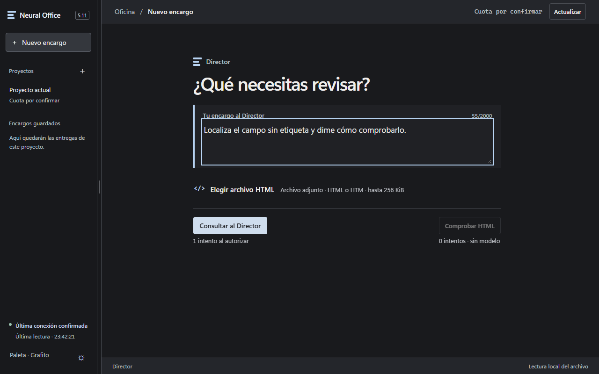

# Neural Office

**V5.12 · escritorio Windows en pruebas.** Escribe qué necesitas revisar y adjunta el HTML. Puedes localizar un problema en una línea concreta con las reglas locales o pedir al Director que comente el documento con tu modelo de Ollama. Neural Office es gratis y de código abierto.

[](https://github.com/ymkaddur/neural-office/actions/workflows/windows-tests.yml?query=branch%3Afeat%2Fv5.12-control)
[](LICENSE)



La comprobación local cuesta **0 intentos**. Una revisión con el modelo cuesta **1 intento al autorizarla**. Cada proyecto tiene tres. Puedes volver a una entrega guardada para leerla de nuevo. [Actividad, saldo y parada en V5.12](docs/V5_12_REVIEW.md) · [Comparar grafito y mineral en V5.11](docs/V5_11_REVIEW.md#grafito-y-mineral-en-el-ejecutable-de-windows) · [Mediciones y pruebas de V5.11](docs/V5_11_REVIEW.md#pruebas-y-consumo-en-windows).

## Qué puedes hacer

- **Revisar un HTML:** idioma, título, alternativas de imágenes y posibles controles sin etiqueta, con ubicación y una acción sugerida.
- **Pedir comentarios al Director:** elige tu modelo instalado en Ollama y autoriza el alcance antes de empezar.
- **Controlar el trabajo:** consulta llamadas, detén la ejecución y vuelve a abrir el informe sin repetirla.
- **Conservar contexto:** consulta el historial y vuelve al borrador durante la misma apertura. La fuente original permanece intacta.

Los hallazgos estáticos y los comentarios del modelo se presentan por separado. El producto lee archivos; no edita repositorios ni ejecuta herramientas propuestas por un modelo.

## Probarlo

Para probar el ejemplo desde la terminal en Windows, extrae la rama de pruebas y ejecuta este comando con Python 3.12. [Código de V5.12](https://github.com/ymkaddur/neural-office/archive/refs/heads/feat/v5.12-control.zip).

```powershell
py -3.12 -B -m neural_office check --root examples --file examples/audit-sample.html
```

Devuelve cuatro hallazgos en JSON y la huella del archivo. No inicia Ollama, crea estado ni consume intentos. [Ejemplos y alcance](docs/HTML_REVIEW.md).

Para abrir el escritorio necesitas Windows x64, Python 3.12 y WebView2. La consulta opcional al Director requiere Ollama y un modelo instalado. Puedes usar el ejecutable de pruebas de GitHub Actions junto con el código de su commit, o compilarlo con Node, Rust y las herramientas de Windows. [Probar el ejecutable de esta rama](docs/V5_12_REVIEW.md) · [Guía de compilación](desktop/README.md).

1. Escribe una pregunta, por ejemplo «¿Qué campo del formulario necesita una etiqueta?». Adjunta `examples/audit-sample.html`.
2. Pulsa **Comprobar HTML**. Abre **Qué revisar** en la fila del control de la línea 7. La pregunta sigue en el borrador.
3. Para pedir una segunda lectura, pulsa **Consultar al Director**. Elige el modelo y revisa el alcance. **Autorizar y ejecutar** reserva el intento. Durante la consulta puedes ver el rol y el tiempo registrado de su llamada.

La consulta asistida empieza con un rol en CPU. Cada proyecto dispone de tres intentos. Un fallo o una cancelación después de reservar también cuenta. [Uso, datos y recuperación](docs/README.md).

## Hacia V6.5

La beta V6 exige instalación probada y un recorrido completo con personas nuevas. Hasta V6.5 se incorporan borradores recuperables, skills que el usuario puede inspeccionar y revocar, y revisiones con un presupuesto explícito. [Hoja de ruta y criterios de aceptación](ROADMAP.md).

En seis tareas con un modelo local pequeño, el Director y la revisión de tres roles dieron las mismas ubicaciones que las reglas. Sus comentarios no añadieron acciones útiles según la rúbrica fijada. [Comparación y costes](docs/V5_7_REVIEW.md).

## Contribuir

Prueba un caso pequeño, describe qué esperabas y qué ocurrió. [Cómo contribuir](CONTRIBUTING.md) · [Pruebas y documentación técnica](docs/README.md) · [Comunicar un problema de seguridad](SECURITY.md).

Los archivos, respuestas y registros se guardan localmente sin cifrar. No adjuntes tu carpeta de estado a un issue. [Frontera de confianza](SECURITY.md) · [Licencias y procedencia](LICENSING.md).

## Apoyo voluntario

[Patreon](https://www.patreon.com/Neural_office): 1 €, 3 €, 5 € o 10 €/mes, sin funciones exclusivas. GitHub Sponsors sigue pendiente de activación. [Detalles del apoyo](docs/SUPPORT.md). Usar Neural Office es gratis.
