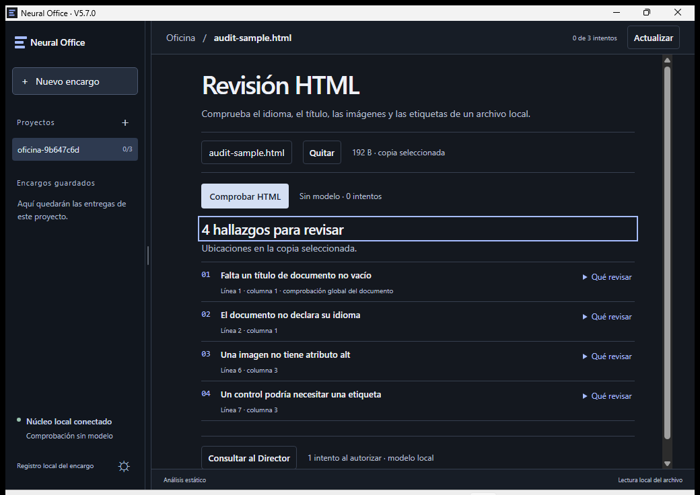

# Neural Office

**Revisa en local. Decide con evidencia.**

Un espacio de trabajo para encargar una revisión, seguir su ejecución y recuperar la entrega. Gratis y open source, con las mismas funciones para todo el mundo.

**V5.8 · candidato local para Windows.** Abre un HTML y localiza qué revisar. La comprobación funciona sin modelo. Si quieres una segunda lectura, puedes pedir comentarios a tu modelo local y recuperar ese encargo desde el historial.

[](https://github.com/ymkaddur/neural-office/actions/workflows/windows-tests.yml)
[](LICENSE)



La captura corresponde al ejecutable V5.7. En V5.8 puedes volver a consultar el mismo encargo tras una desconexión y abrir su historial durante el trabajo. [Pruebas locales de reconexión](docs/V5_8_REVIEW.md) · [Comparación de modelos en V5.7](docs/V5_7_REVIEW.md).

## Qué puedes hacer

- **Revisar un HTML:** idioma, título, alternativas de imágenes y posibles controles sin etiqueta, con ubicación y una acción sugerida.
- **Pedir comentarios al Director:** elige tu modelo instalado en Ollama y autoriza el alcance antes de empezar.
- **Controlar el trabajo:** consulta llamadas, detén la ejecución y vuelve a abrir el informe sin repetirla.
- **Conservar contexto:** consulta el historial y vuelve al borrador durante la misma apertura. La fuente original permanece intacta.

Los hallazgos estáticos y los comentarios del modelo se presentan por separado. El producto lee archivos; no edita repositorios ni ejecuta herramientas propuestas por un modelo.

## Probarlo

**Sin modelo:** con Windows y Python 3.12, [descarga el código](https://github.com/ymkaddur/neural-office/archive/refs/heads/main.zip), extrae la carpeta y ejecuta desde ella:

```powershell
py -3.12 -B -m neural_office check --root examples --file examples/audit-sample.html
```

Devuelve cuatro hallazgos en JSON y la huella del archivo. No inicia Ollama, crea estado ni consume intentos. [Ejemplos y alcance](docs/HTML_REVIEW.md).

**En el escritorio:** sigue la [guía de compilación y uso](desktop/README.md). Necesita Windows x64, Python 3.12 y WebView2. La consulta opcional al Director requiere Ollama y un modelo instalado. Compilar requiere Node, Rust y las herramientas de Windows. Todavía se distribuye como código para desarrollo, sin instalador firmado.

1. Pulsa **Elegir archivo HTML** y **Comprobar HTML**. Puedes recorrer todas las ubicaciones sin gastar intentos.
2. Abre **Qué revisar** junto a un hallazgo para decidir cómo comprobarlo en tu documento.
3. **Consultar al Director** conserva la fuente. Revisa el número de llamadas y autoriza el encargo si te interesa guardarlo con comentarios.

La consulta asistida empieza con un rol en CPU. Cada proyecto dispone de tres intentos. Un fallo o una cancelación después de reservar también cuenta. [Uso, datos y recuperación](docs/README.md).

## Hacia V6

Primero, utilidad demostrada y una experiencia consistente. Después, memoria inspeccionable, optimización con la misma calidad y distribución sencilla. [Hoja de ruta y criterios de aceptación](ROADMAP.md).

En seis tareas con un modelo local pequeño, el Director y la revisión de tres roles dieron las mismas ubicaciones que las reglas. Sus comentarios no añadieron acciones útiles según la rúbrica fijada. [Comparación y costes](docs/V5_7_REVIEW.md).

## Contribuir

Prueba un caso pequeño, describe qué esperabas y qué ocurrió. [Cómo contribuir](CONTRIBUTING.md) · [Pruebas y documentación técnica](docs/README.md) · [Comunicar un problema de seguridad](SECURITY.md).

Los archivos, respuestas y registros se guardan localmente sin cifrar. No adjuntes tu carpeta de estado a un issue. [Frontera de confianza](SECURITY.md) · [Licencias y procedencia](LICENSING.md).

## Apoyo voluntario

[Patreon](https://www.patreon.com/Neural_office): 1 €, 3 €, 5 € o 10 €/mes, sin funciones exclusivas. GitHub Sponsors sigue pendiente de activación. [Detalles del apoyo](docs/SUPPORT.md). Usar Neural Office es gratis.
