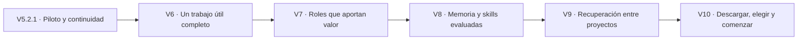

# De un piloto útil a tu oficina local

**Visión:** descargar la aplicación, elegir un modelo local compatible y poner a trabajar un equipo con tareas, memoria y skills bajo control del usuario.

## Visión para usuarios

| Hito | Qué ganas | Estado |
| --- | --- | --- |
| V5.2.1 | Auditar un HTML, detener la tarea, conservar informes y presupuesto al recuperar estado. | Vista previa Windows; timeout de arranque aún bajo investigación |
| V6 | Completar una tarea útil de principio a fin con resultado comprobable. | Siguiente hito |
| V7 | Elegir cuántos roles necesitas con evidencia sobre calidad, coste y espera. | Planificado |
| V8 | Reutilizar conocimiento y skills que demuestren ayudar en tu trabajo. | Planificado |
| V9 | Continuar tras fallos y gestionar dos proyectos sin perder autoridad ni resultados. | Planificado |
| V10 | Instalar, seleccionar un modelo y empezar sin gestionar Python o scripts. | Objetivo de distribución |

En V6 se propone experimentar con **una skill declarativa de solo lectura y memoria consultable**, antes de habilitar aprendizaje o promoción automática. El primer objetivo es utilidad medible con procedencia; incorporar instrucciones sin evaluación no basta para cerrar el hito.

No se asignan trimestres sin una estimación de capacidad y resultados del siguiente ciclo. Las versiones se cierran por evidencia, no por una fecha inventada. Antes de comprometer una fecha V6 se debe fijar un caso de uso, un conjunto de evaluación y un presupuesto de trabajo.

## Criterios técnicos de salida

| Hito | Dependencia y evidencia requerida |
| --- | --- |
| V5.1 documental | Contrato, integración y procedencia revisados; publicación documental separada del código operativo. |
| V5.2 / V5.2.1 | Preservar los recibos originales. Conciliación y restauración verificadas dentro de su alcance; 401 corregido. R13 permanece abierto y los clientes externos no participan todavía en la exclusión. |
| V6 | Un caso útil de web-auditor en CPU, entrada y resultado reproducibles, evaluación independiente, cancelación y reanudación conservando cuotas. Resolver o acotar operacionalmente R13 antes de anunciar un arranque fiable. Ensayar skill/memoria mínimas aisladas. |
| V7 | Comparación controlada 1/3/7 roles: calidad, latencia y consumo por familia de tareas. Una puntuación del propio modelo no será el único verificador. |
| V8 | Procedencia, aislamiento por proyecto, recuperación relevante, borrado controlado y promoción de skills con evaluación fuera del conjunto usado para crearlas. Probar regresión y rollback. |
| V9 | Fallos parciales, dos proyectos y una inferencia administrada; restauración de todos los componentes, idempotencia y exclusión de las integraciones realmente incluidas. Distinguir pérdida del ledger de pérdida de todos los testigos. |
| V10 | Máquina Windows limpia, modelo compatible, instalación, actualización y desinstalación probadas; SBOM del paquete real, licencias/avisos de cada componente, revisión del nombre y responsabilidades de distribución. Evaluar otras plataformas por separado. |

OpenCode y CrewAI se evaluarán por necesidad, compatibilidad y procedencia. Su presencia en el legado no obliga a distribuirlos. No se anunciará un instalador autónomo ni una oficina generalista antes de demostrar esas capacidades.

Para contribuir ahora: reproducir R13 con la instrumentación publicada, probar la recuperación en un entorno Windows independiente y aportar casos HTML con resultados esperados. [Protocolo de contribución](CONTRIBUTING.md) · [Registro forense](docs/V5_2_1_FORENSIC_REVIEW.md).
