# De un piloto útil a tu oficina local

**Visión:** descargar la aplicación, elegir un modelo local compatible y poner a trabajar un equipo con tareas, memoria y skills bajo control del usuario. Software gratuito, MIT para las aportaciones propias y apoyo voluntario sin funciones exclusivas.

```mermaid
flowchart LR
    A["V5.3 · Medir y diseñar"] --> B["V5.4 · Diseño y referencia"]
    B --> C["V5.5 · Conectar el escritorio"]
    C --> D["V6 · Completar un trabajo"]
    D --> E["V7 · Coordinar con criterio"]
    E --> F["V8 · Memoria y skills"]
    F --> G["V9 · Resiliencia"]
    G --> H["V10 · Instalar y comenzar"]
```

## Visión y pruebas de salida

| Hito | Qué ganas | Trabajo principal | Condición de salida |
| --- | --- | --- | --- |
| **V5.3 — referencia y diseño** | Ver cuánto cuesta el piloto y explorar la futura oficina | Colector optativo, ensayos 1/3/7, discriminantes R13, contrato de mensajes y demo React/TypeScript | Entregado: 125 pruebas Python, siete de frontend, build y revisión de UI; seis intentos reales aceptados. R13 abierto; demo sin motor |
| **V5.4 — diseño + base medida** | Revisar cinco estados claros y conocer el coste observado | Prototipo Director/entrega, fuentes y diff; medidas separadas de UI y backend; corpus y comparaciones controladas pendientes | Aceptación visual G-UI, ajustes cerrados y presupuesto de recursos ratificado. [Progreso y crítica](docs/V5_4_UI_REVIEW.md); no se declara completado |
| **V5.5 — escritorio operativo** | Una interfaz moderna para el trabajo real, sin comandos cotidianos | Host Tauri 2, frontend actual, sidecar Python, selector real, eventos, informes, permisos y recuperación | Recorrido real completo; errores/desconexión/cancelación; cuotas e idempotencia; medición separada de UI/core/modelo; teclado. Primer paquete de prueba, no todavía distribución autónoma V10 |
| **V6 — tarea útil completa** | Encargar un trabajo acotado y recibir un resultado revisable | Director con plan y loops limitados; una skill declarativa de solo lectura; memoria mínima consultable por proyecto | Corpus con resultado esperado, verificador independiente, límites de tiempo/tokens/llamadas, parada sin progreso y checkpoints. Resolver o acotar operacionalmente R13 antes de anunciar arranque fiable |
| **V7 — coordinación eficiente** | Usar el número de roles que aporte valor | Routing 1/3/7 según tarea, contexto selectivo, herramientas, revisión y síntesis | Comparar calidad, coste, latencia y memoria contra un rol; el director no añade rondas sin ganancia demostrable. Una autoevaluación del modelo no es la única evidencia |
| **V8 — memoria y skills evaluadas** | Reutilizar conocimiento sin acumular errores invisibles | Procedencia, aislamiento por proyecto, vigencia, recuperación relevante, borrado y promoción de skills | Evaluación fuera del conjunto usado para crearlas, resistencia a instrucciones maliciosas, permisos mínimos, regresión y rollback. Consolidación con presupuesto explícito |
| **V9 — resiliencia y varios proyectos** | Continuar tras fallos conservando control y resultados | Planificador con cuotas y prioridad, dos proyectos y una inferencia administrada por defecto; backups y migración | Fallos parciales, muerte de procesos, eventos duplicados y restauración integral; exclusión probada para cada integración incluida. Concurrencia extra solo si la memoria y la evaluación lo justifican |
| **V10 — distribución sencilla** | Instalar, elegir un modelo y comenzar | Detección de hardware, onboarding, perfiles compatibles, actualización, diagnóstico y desinstalación | Máquina Windows limpia; instalación sin Python/Node/Rust manuales; modelo compatible; actualización/restauración probadas; SBOM y avisos del paquete real; revisión del nombre y responsabilidades de distribución |

Las versiones se cierran por capacidades y evidencia, no por numeración o fechas inventadas. Linux/macOS requieren su propio plan y pruebas: el control de procesos actual usa Windows Jobs, sin constituir un sandbox de disco/red. La elección de Tauri no garantiza por sí sola un instalador pequeño o menor RAM; hay que contar webview, Python, runtime y pesos por separado.

## Tramo actualizado hacia V6

La numeración organiza puertas de salida; no fija fechas ni declara implementadas las capacidades. V5.4.1 publica progreso revisable y divisores ajustables. G-UI continúa pendiente de aceptación y pruebas formativas.

La [auditoría posterior](docs/FORENSIC_AUDIT_V5_4_1.md) incorpora mantenimiento del núcleo 5.3.1: propiedad durante arranque/recuperación, reintento de protección interrumpida y rechazo temprano de rutas de red. Antes de ampliar capacidades, la prioridad es demostrar un solo recorrido con identidad durable, respuesta perdida, cierre y recuperación. El coste de validar toda la historia debe medirse dentro de la latencia de cancelación. Esto no cierra G-UI ni conecta el escritorio.

| Fase | Resultado para el usuario | Condición antes de avanzar |
| --- | --- | --- |
| V5.4 | Director, contexto, borrador, resultado, error y parada comprensibles | Cinco pantallas aceptadas, paneles ajustables, prueba formativa y referencia reproducible de recursos |
| V5.4.1 | Compositor contextual, tres etapas, paneles ajustables y atención al cierre | Revisar las cinco escenas pulidas; las [correcciones y límites](docs/V5_4_1_UI_REVIEW.md) no certifican todavía G-UI |
| V5.5 | Elegir modelo y fuente, ejecutar y detener desde el escritorio | Transporte Tauri/Python restringido, autoridad del núcleo, eventos con secuencia, recuperación e idempotencia; medir el conjunto |
| V5.6 | Plan breve, primera entrega y revisión con salida anticipada | Hasta tres iteraciones internas propuestas, sin confundirlas con intentos; llamadas/tokens/tiempo acotados; comparar con una pasada |
| V5.7 | Skills de solo lectura y memoria mínima inspeccionable | Fuente, versión, permisos, ámbito, borrado y actualizaciones atómicas; nada generado se promociona por sí solo |
| V5.8 | Menor coste del recorrido completo con utilidad conservada | Corpus independiente, un cambio por experimento, carga/prefill/generación separados; sin activar siete roles por estética |
| V5.9 | Uso estable con errores, cierres y restauraciones | Beta con usuarios, accesibilidad, casos largos, treinta ciclos y recuperación adversarial; R13 resuelto o contenido explícitamente |
| V6 | Dos trabajos acotados desde la app: HTML y síntesis de TXT/Markdown seleccionados | Entregas verificables, fuentes y versiones, límites, persistencia y recursos contrastados; paquete de prueba, no soporte universal |

La optimización se mantiene en cada fase. V5.8 integra los ahorros comprobados; no es permiso para ignorar consumo antes. Los presupuestos provisionales y lo aún no medido figuran en [V5.4 recursos](docs/V5_4_RESOURCE_BASELINE.md). La investigación dirigida de vídeos orienta contexto selectivo, memoria con procedencia y separación de fases de inferencia; no aporta cifras transferibles a este equipo.

## Optimización transversal

1. **Medir antes/después:** arranque, primera carga, prefill/generación, tiempo total, CPU acumulada, RAM residente/comprometida, VRAM y calidad. Añadir TTFT cuando exista streaming real. Registrar fallos y observaciones desconocidas.
2. **Un modelo compartido, trabajo acotado:** roles lógicos seriales como base; prompts con contexto necesario; salida y ciclos limitados; parada por presupuesto o falta de progreso. Mantener un modelo entre intentos exige rediseñar y probar su ownership, no solo aumentar keep_alive.
3. **CPU/GPU según capacidad observada:** memoria de pesos + contexto/caché + buffers + margen del sistema. Probar perfiles antes de ofrecerlos; manejar falta de memoria sin duplicar trabajo o reembolsar cuotas accidentalmente. El modelo y su licencia se eligen por separado del programa.
4. **Interfaz ligera y honesta:** eventos acotados, historial paginado, sin re-renderizar un log infinito, trabajo pesado fuera de la webview y estados de espera visibles. El navegador de demo no es una medida de la aplicación empaquetada.
5. **Recursos comparados con utilidad:** ningún ahorro se acepta solo por tokens/s. El mismo corpus debe conservar resultados útiles y las pruebas de autoridad, cancelación y recuperación.

## Continuidad con el legado

V5.1 conserva contratos documentales. V5.2/V5.2.1 aportan piloto, conciliación y restauración en su dominio declarado; R14 se corrigió con una firma reproducida y R13 sigue abierto. El testigo vigente de continuidad debe conservarse: revertir juntos ledger y todos los testigos es un límite conocido.

V5.3 mantiene intactos los caminos de ejecución del núcleo e incorpora observación y diseño. CrewAI y OpenCode siguen sujetos a necesidad, compatibilidad y procedencia; su presencia histórica no obliga a distribuirlos. Cualquier adaptador futuro deberá emplear interfaces y condiciones verificadas de su proveedor, sin basar la oficina local en esa dependencia.

La investigación visual de vídeos está [delimitada por frames y timestamps](docs/V5_3_VIDEO_RESEARCH.md). Las pistas sobre caché, memoria y evaluación alimentan experimentos futuros; no se anuncian como capacidades ya incorporadas.

**Siguiente trabajo concreto:** cerrar aceptación de las cinco pantallas V5.4.1 y fijar una tarea/rúbrica; después conectar un solo recorrido y probar pérdida de respuesta, cierre/reinicio y conservación de identidad/cuota. Ampliar el corpus y medir recursos con esa tarea estable. Las comparaciones CPU/GPU/contexto varían una condición por ensayo y preservan los recibos anteriores. [Referencia medida](docs/V5_3_MEASUREMENT_PROTOCOL.md) · [contrato de escritorio](docs/V5_3_DESKTOP_CONTRACT.md) · [auditoría actual](docs/FORENSIC_AUDIT_V5_4_1.md).
