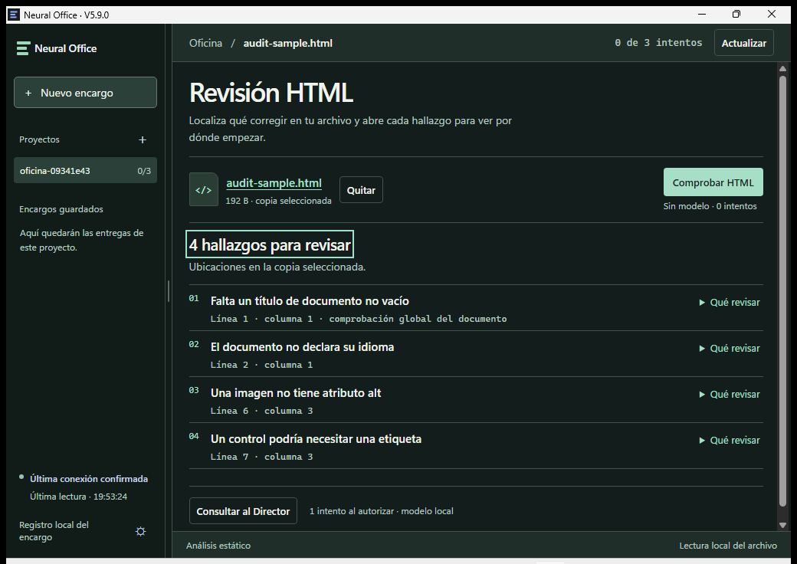
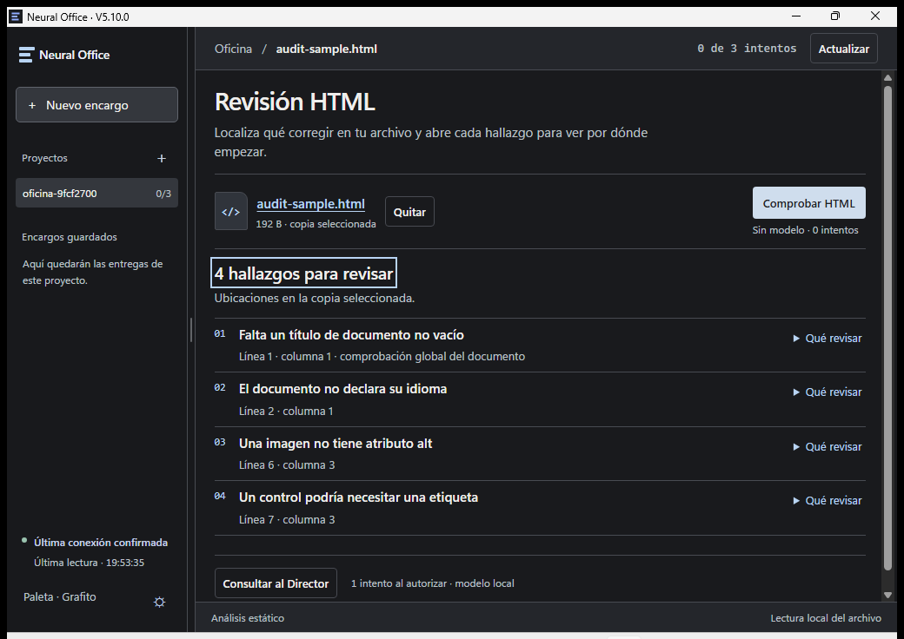

# V5.10 · detener el encargo correcto

Esta rama de prueba permite comparar el escritorio grafito con V5.9 y seguir una revisión de HTML hasta su entrega. La comprobación del archivo sigue disponible al agotar los tres intentos del proyecto.

## Comparar el escritorio

| V5.9 original | V5.10 grafito |
|---|---|
|  |  |

Las capturas usan el mismo archivo público y muestran sus cuatro hallazgos. En V5.10, el botón **Paleta · Grafito** permite recuperar el acabado mineral mientras se revisa el mismo documento. El botón de tema controla claro y oscuro por separado. La variante usa Segoe UI de Windows, una cabecera de 28–35 px y cifras tabulares en las posiciones. Las indicaciones de estado también se expresan con texto. [Acabado mineral en V5.10](images/v5.10-mineral.png) · [Archivo de ejemplo](../examples/audit-sample.html).

## Qué se corrigió

| Situación | Qué debe poder comprobar la persona |
|---|---|
| Hay un trabajo en curso y se consulta otro encargo | La franja de parada identifica el objetivo activo. Una lectura pendiente del historial permite solicitar su parada. El núcleo conserva la identidad y el cargo de cada encargo. |
| El núcleo confirma el fin y falla la lectura siguiente | El estado terminal se muestra de inmediato. La cuota queda pendiente de actualización. Reconectar recupera el saldo del mismo proyecto. |
| Un proyecto consume su tercer intento | La aprobación queda fuera de alcance. La comprobación local y el historial siguen accesibles. Una aprobación caducada tiene su propio diagnóstico. |
| Llega el informe mientras se consulta Evidencia | Se conserva la pestaña elegida. El borrador que se está escribiendo sigue disponible durante la misma apertura. |
| Cambia la página de proyectos o la revisión del historial | El saldo conservado está vinculado al proyecto, a la sesión y a la revisión. El historial puede recibir una lectura más reciente para el mismo proyecto. |
| Una etiqueta solo contiene texto oculto | Se indica la posición del control. Una referencia directa por `aria-labelledby` puede tomar su nombre de texto oculto. Esta distinción se contrastó con el árbol de accesibilidad de Edge. |
| Un SVG o una plantilla tienen título, o la fuente usa retorno de carro | La regla utiliza el primer título del documento HTML y ubica cada hallazgo con línea y columna. La huella procede de los bytes originales, incluso cuando CR, LF y CRLF dan las mismas posiciones. |

La versión de reglas es `static-html-checks-v4`. Los informes aceptados con versiones 1–3 se muestran a partir de sus bytes y huellas guardados. El analizador estático cubre casos definidos de HTML y atributos de estilo. La cascada de hojas de estilo externas, el DOM construido por scripts y una evaluación completa de accesibilidad requieren comprobar la página en un navegador.

## Coste y límites de la medición

La comparación de interfaz usa dos ventanas nuevas por variante. El orden de la segunda ronda invierte el de la primera. En cada ventana se observan tres segundos de reposo y dos comprobaciones del mismo documento. El intervalo de trabajo comienza al activar **Comprobar HTML** y termina cuando UI Automation puede leer el resultado. El selector de archivos queda fuera de ese intervalo. La CPU se expresa en segundos acumulados del árbol de procesos del Job Object. La RAM es el máximo muestreado de su conjunto residente y puede contar páginas compartidas más de una vez. El arranque incluye el tiempo hasta que el observador lee la conexión del núcleo. [Ensayo reproducible de Windows](../tools/verify_v510_desktop.py).

**Escritorios en el mismo runner Windows, 1024 × 697 píxeles de cliente a 96 DPI.** Cada fila resume dos ventanas. Los tiempos de la tabla son medianas. La última columna muestra el mayor pico de RAM de las dos repeticiones. La frecuencia de muestreo fue de unas diez observaciones por segundo.

| Versión y paleta | CPU en 3 s de reposo | Primera comprobación | Repetición | CPU en la repetición | Pico RAM en la repetición |
|---|---:|---:|---:|---:|---:|
| V5.9 original | 0,156 s | 0,862 s | 0,243 s | 0,188 s | 410,4 MiB |
| V5.10 mineral | 0,125 s | 0,557 s | 0,248 s | 0,227 s | 409,0 MiB |
| V5.10 grafito | 0,086 s | 0,243 s | 0,242 s | 0,242 s | 408,3 MiB |

La repetición dio tiempos de pared próximos en las tres variantes. Grafito usó algo más de CPU que V5.9 en ese intervalo. El orden de apertura, las cachés del sistema y la cadencia de UI Automation pueden influir en las diferencias de la primera comprobación. [Seis ventanas y métricas por recorrido](evidence/V5_10_WINDOWS.json) · [Ejecución de Windows y binarios de prueba](https://github.com/ymkaddur/neural-office/actions/runs/44382596583).

**Coste de Ollama en Windows local.** El mismo ejecutable de V5.10 se probó con `qwen2.5:0.5b` instalado y una oficina de prueba independiente por perfil. La primera y la segunda pasada usaron el mismo ejemplo en la misma ventana. El medidor arranca al comprobar el HTML o confirmar la autorización y termina al poder leer los cuatro hallazgos y, en las consultas, la entrega. Cada consulta inicia su proceso de inferencia administrado. La repetición conserva la ventana y puede aprovechar cachés del sistema. Las cifras de CPU suman el trabajo en varios núcleos.

| Perfil | Llamadas / intentos por pasada | Tiempo primera / repetida | CPU primera / repetida | Pico RAM primera / repetida |
|---|---:|---:|---:|---:|
| Comprobación estática | 0 / 0 | 0,149 / 0,143 s | 0,172 / 0,094 s | 553,7 / 561,2 MiB |
| Director | 1 / 1 | 37,525 / 13,102 s | 29,219 / 20,531 s | 1195,2 / 1255,1 MiB |
| Director, revisor e integrador | 3 / 1 | 21,180 / 18,905 s | 44,125 / 45,750 s | 1377,7 / 975,3 MiB |

Las lecturas del registro confirmaron el número de llamadas y cargos después de cada entrega. Al cerrar cada ventana quedó vacío su árbol de procesos. Los tres roles consumieron más CPU en ambas pasadas. La primera consulta de un rol tardó más que la de tres. Estas dos observaciones por perfil dejan abierta la variabilidad del arranque. Este recorrido mide coste y conserva la evaluación de utilidad de V5.7 como experimento separado. [Datos y huellas de los dos entornos](evidence/V5_10_WINDOWS.json) · [Evaluación de utilidad](V5_7_REVIEW.md).

Para repetir el ensayo local, usar Python con las dependencias de las pruebas nativas, un directorio nuevo de salida y el SHA-256 contrastado del ejecutable. Desde la raíz del repositorio, ejecutar el comando una vez con cada valor de `--arm` (0, 1 y 3). La versión probada está en el artefacto del flujo enlazado arriba. El modelo y su huella se comprueban antes de un perfil asistido. [Medidor de escritorio](../tools/measure_v58_desktop.py).

```powershell
python -B -m tools.measure_v58_desktop --executable $exe --expected-sha256 a4e9aa99fb0de656010d29ab980bb542d58057656add979582360a7235ac7c24 --version 5.10.0 --output $directorioNuevo --arm 0
```

Dentro de cada entorno las variantes usan los mismos bytes. El checkout de Actions obtuvo el ejemplo con finales CRLF (192 bytes) y el local con LF (183 bytes). Ambos produjeron cuatro hallazgos. La huella distingue esas fuentes.

## Prueba de parada y reconexión

Con el ejecutable V5.9 se abrió un encargo guardado mientras otro seguía activo. La acción de parada desapareció al cambiar de vista. En otro recorrido, tras confirmar la cancelación desde un segundo cliente y provocar un fallo de lectura del saldo, el registro ya contenía `CANCELLED` mientras la ventana seguía mostrando «Encargo registrado».

En V5.10 se comprobaron dos recorridos con tres intentos ya reservados. En el primero se pulsó **Detener** desde la vista del encargo guardado. En el segundo se canceló desde otro cliente y se interrumpió una lectura de saldo durante la consulta periódica. En ambos quedó una única confirmación de parada en el encargo activo y el total siguió en tres. Se comprobó la identidad del encargo consultado, la recuperación del saldo y la posibilidad de revisar otro HTML con la cuota agotada. Las lecturas se interrumpieron en un auxiliar temporal del ensayo. [Pruebas nativas](../tools/verify_v510_desktop.py) · [Recibos agregados de Windows](evidence/V5_10_WINDOWS.json).

## Historiales grandes

En Windows local se leyeron páginas de ocho eventos con el testigo de continuidad activo. Se alternaron una página antigua y una reciente durante 24 lecturas medidas de cada una. Con 50 proyectos, la mediana de la página reciente fue 2,04 ms con 100 eventos y 23,33 ms con 10.000. En una lectura antigua instrumentada del caso grande, el cálculo completo de la firma ocupó 20,75 de 23,08 ms. Una optimización del historial debe conservar el rechazo de una base y un testigo que divergen. [Medidor de historial](../tools/measure_v510_history.py) · [Implementación de la firma](../neural_office/continuity.py).

Las comprobaciones HTML adicionales también cuestan tiempo. En el formulario de 800 controles la mediana de 40 pasadas alternadas fue 7,95 ms con V5.9 y 8,73 ms con V5.10. El ejemplo público pasó de 0,036 a 0,042 ms. Son tiempos del analizador Python con los bytes ya disponibles. [Comparación del analizador](../tools/compare_v59_html.py).

## Alcance de la evaluación visual

En la vista estática de grafito se midieron diez pares de texto y fondo en cada tema. El contraste mínimo fue 8,30:1 en oscuro y 6,26:1 en claro. Las cuatro ubicaciones quedaron a la vista a 1440 × 900 y 1024 × 697. A 390 × 720 y 768 × 540, el último hallazgo se desplazó a la vista al recibir el foco y Enter abrió su detalle. Estas mediciones corresponden al cliente compilado en Edge con respuestas de prueba. Las capturas de comparación y las pruebas de parada proceden de los ejecutables de Windows.

Quedan por medir la primera pintura nativa, la respuesta de Narrador y NVDA durante la reconexión, la evolución de la memoria en sesiones de varias horas y la preferencia entre paletas con personas que hagan el mismo encargo. Las dos rondas permiten comparar lo observado en esos recorridos. Para estimar el consumo habitual se necesitan más equipos y repeticiones.
