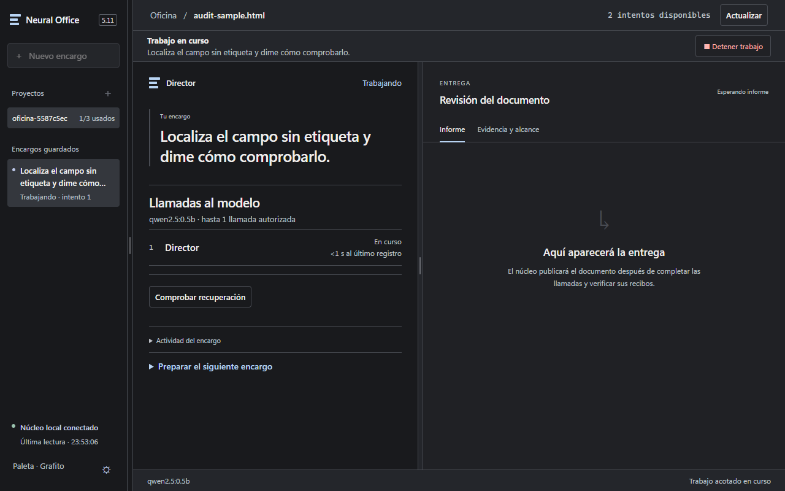

# V5.11 · Del encargo a la entrega

En V5.10 el primer paso era elegir un HTML. En V5.11 puedes escribir qué decisión necesitas tomar antes de elegir el archivo, comprobarlo con reglas locales y llevar la misma pregunta al Director. Grafito y mineral comparten composición y tipografía. El saldo indica los intentos disponibles. Cada reserva cuesta uno, incluso si la ejecución termina en fallo o cancelación.

## Un recorrido que puedes repetir

1. Escribe «Localiza el campo sin etiqueta y dime cómo comprobarlo». Adjunta [el formulario de ejemplo](../examples/audit-sample.html).
2. Pulsa **Comprobar HTML**. Aparecen cuatro hallazgos. El campo está en la línea 7, columna 3. La petición al modelo sigue sin autorizar.
3. Pulsa **Consultar al Director**. La pregunta y el adjunto siguen presentes. Si una consulta actual confirma que faltan modelos compatibles, puedes conservar el borrador mientras preparas Ollama. Si el núcleo está ocupado y solo devuelve una lista antigua, la pantalla indica que debes esperar y actualizar.
4. **Revisar encargo** muestra el alcance y el coste. **Autorizar y ejecutar** reserva el intento. La lista de llamadas presenta rol y estado. Para una llamada terminada, la duración procede de sus dos recibos. Durante una llamada activa, el tiempo visible corresponde a la última lectura del núcleo. Un intervalo incompleto o invertido se omite.
5. Abre la entrega desde el historial. Comprueba el mismo intento, su informe y el saldo. Los comentarios aparecen separados de las ubicaciones determinadas por reglas.

## Evidencia y límites

Las capturas de esta página y del README proceden del renderer compilado en Edge para Windows conectado por una sonda de prueba al núcleo Python real. La sonda entrega al selector el único ejemplo público. En ese recorrido se observaron cuatro hallazgos, cero consultas al catálogo antes de la comprobación, cero reservas hasta la autorización y la misma pregunta al volver al Director.

Al autorizar el ejemplo con `qwen2.5:0.5b`, la oficina registró un intento aceptado y una llamada terminada. Una primera ejecución reveló que el historial podía seguir indicando «Encargo registrado» mientras el Director ya mostraba la llamada en curso. La fila del historial usa ahora la revisión más reciente del mismo intento y sesión que ya recibió el Director. Las demás filas conservan su propio estado.

En Windows se midió el contraste del título, la etiqueta, el texto del encargo, la indicación del archivo, el coste y el botón principal. El mínimo entre esos seis elementos fue 8,82:1 en grafito oscuro, 6,26:1 en grafito claro, 9,14:1 en mineral oscuro y 6,28:1 en mineral claro. A 390 píxeles de ancho, las dos acciones cabían en la ventana sin desplazamiento horizontal.

Las regresiones del escritorio cubren composición por teclado, conservación del borrador y catálogo vacío seguido de un error y una recuperación. Las del núcleo cotejan el inicio y el fin de dos intentos distintos con los recibos guardados y vuelven a leerlos tras reabrir la oficina. La cancelación, la reconexión y el recuento de llamadas conservan pruebas específicas. [Pruebas del escritorio](../desktop/src/connected/adversarial.test.ts) · [Pruebas del núcleo](../tests/test_v55_service.py).

El trabajo en Windows Actions incluye la compilación del ejecutable, el selector nativo, la revisión con Ollama y la comparación en la misma máquina con V5.10. El resultado de cada ejecución se consulta por commit. [Ejecuciones de la rama](https://github.com/ymkaddur/neural-office/actions/workflows/windows-tests.yml?query=branch%3Afeat%2Fv5.11-director).

Queda por medir si una persona nueva reconoce la acción gratuita y el momento del cargo, así como su experiencia de lectura prolongada y con lector de pantalla. La duración registrada mide tiempo de pared entre eventos del núcleo y puede incluir espera. Los ajustes o temas gráficos son independientes de la capacidad del modelo para producir comentarios útiles.
