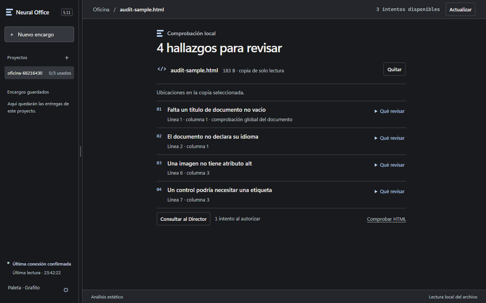
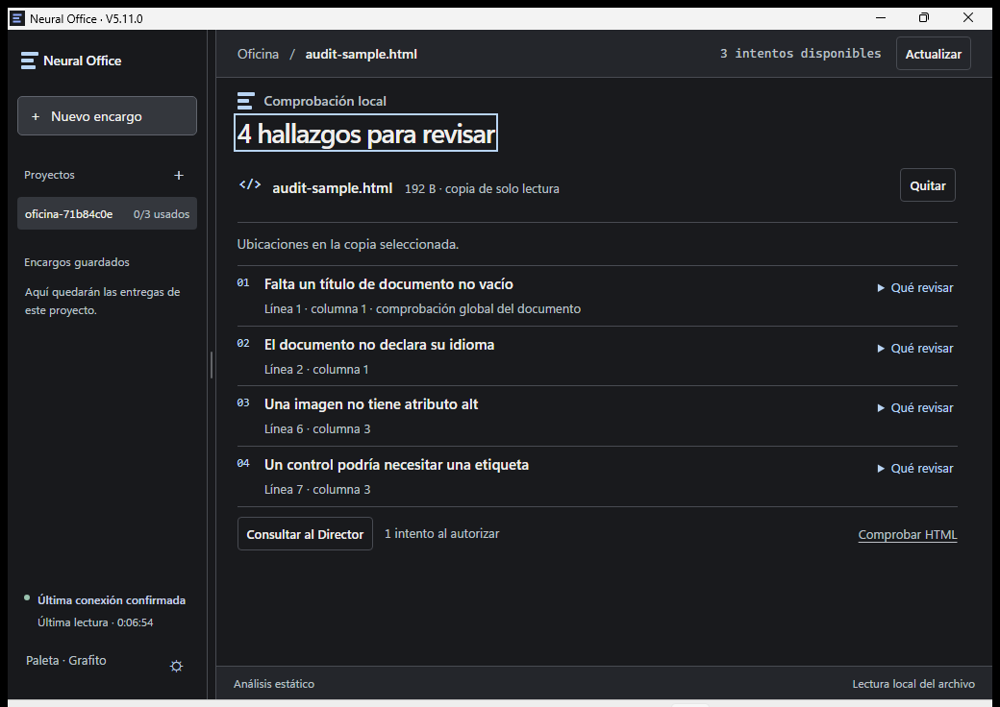
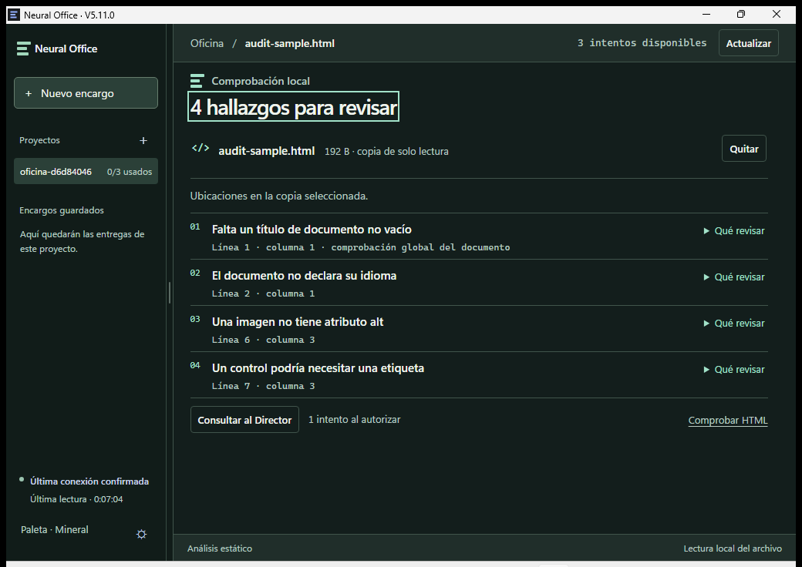

# V5.11 · Del encargo a la entrega

En V5.10 el primer paso era elegir un HTML. En V5.11 puedes escribir qué decisión necesitas tomar antes de elegir el archivo, comprobarlo con reglas locales y llevar la misma pregunta al Director. El saldo indica los intentos disponibles. Cada reserva cuesta uno, incluso si la ejecución termina en fallo o cancelación.

## Un recorrido que puedes repetir

1. Escribe «Localiza el campo sin etiqueta y dime cómo comprobarlo». Adjunta [el formulario de ejemplo](../examples/audit-sample.html).
2. Pulsa **Comprobar HTML**. Aparecen cuatro hallazgos. El campo está en la línea 7, columna 3. La petición al modelo sigue sin autorizar.
3. Pulsa **Consultar al Director**. La pregunta y el adjunto siguen presentes. Si una consulta actual confirma que faltan modelos compatibles, puedes conservar el borrador mientras preparas Ollama. Si el núcleo está ocupado y solo devuelve una lista antigua, la pantalla indica que debes esperar y actualizar.
4. **Revisar encargo** muestra el alcance y el coste. **Autorizar y ejecutar** reserva el intento. La lista de llamadas presenta rol y estado. Para una llamada terminada, la duración procede de sus dos recibos. Durante una llamada activa, el tiempo visible corresponde a la última lectura del núcleo. Un intervalo incompleto o invertido se omite.
5. Abre la entrega desde el historial. Comprueba el mismo intento, su informe y el saldo. Los comentarios aparecen separados de las ubicaciones determinadas por reglas.



## Evidencia y límites

La captura del README y las de hallazgos y llamada de este apartado proceden del renderer compilado en Edge para Windows conectado por una sonda de prueba al núcleo Python real. La sonda entrega al selector el único ejemplo público. En ese recorrido se observaron cuatro hallazgos, cero consultas al catálogo antes de la comprobación, cero reservas hasta la autorización y la misma pregunta al volver al Director.

Al autorizar el ejemplo con `qwen2.5:0.5b`, la oficina registró un intento aceptado y una llamada terminada. Una primera ejecución reveló que el historial podía seguir indicando «Encargo registrado» mientras el Director ya mostraba la llamada en curso. La fila del historial usa ahora la revisión más reciente del mismo intento y sesión que ya recibió el Director. Las demás filas conservan su propio estado.


En Windows se midió el contraste del título, la etiqueta, el texto del encargo, la indicación del archivo, el coste y el botón principal. El mínimo entre esos seis elementos fue 8,82:1 en grafito oscuro, 6,26:1 en grafito claro, 9,14:1 en mineral oscuro y 6,28:1 en mineral claro. A 390 píxeles de ancho, las dos acciones cabían en la ventana sin desplazamiento horizontal.

Las regresiones del escritorio cubren composición por teclado, conservación del borrador y catálogo vacío seguido de un error y una recuperación. Las del núcleo cotejan el inicio y el fin de dos intentos distintos con los recibos guardados y vuelven a leerlos tras reabrir la oficina. La cancelación, la reconexión y el recuento de llamadas conservan pruebas específicas. [Pruebas del escritorio](../desktop/src/connected/adversarial.test.ts) · [Pruebas del núcleo](../tests/test_v55_service.py).

## Grafito y mineral en el ejecutable de Windows

Abre ambas capturas a tamaño completo y compara la ubicación «Línea 7 · columna 3», el texto de la acción y el saldo en la esquina superior derecha. Se tomó la misma vista de cuatro hallazgos con el mismo ejecutable a 96 DPI. Grafito usa una fuente de sistema de 13 px con cifras tabulares en las ubicaciones. Mineral usa una monoespaciada de 12 px. También cambian el título y el interlineado. [Estilos de la versión medida](https://github.com/ymkaddur/neural-office/blob/e0052fc6de020e7ae4ad27749fcb8522029cbbb2/desktop/src/connected/connected.css#L133-L156).

| Grafito | Mineral |
| --- | --- |
| [](images/v5.11-native-graphite.png) | [](images/v5.11-native-mineral.png) |

## Pruebas y consumo en Windows

El ejecutable de prueba completó 13 comprobaciones con WebView2, selector nativo y Ollama. Tras una entrega aceptada, cerrar y reabrir conservó el intento y la llamada. En un segundo encargo, cancelar después de reservar dejó el total en dos intentos, una llamada y dos estados finales, aceptado y cancelado. [Ejecución y artefactos originales](https://github.com/ymkaddur/neural-office/actions/runs/44425005101).

Cada celda muestra **primera ejecución / repetición**. Se usó una ventana y un registro nuevos para cada modalidad, con la caché del sistema operativo disponible. La CPU es tiempo acumulado del grupo de procesos. La RAM es el máximo observado de la suma de sus conjuntos de trabajo y puede contar páginas compartidas varias veces. [Mediciones individuales, saldos y huellas](evidence/V5_11_WINDOWS.json).

| Entorno y tarea | Tiempo transcurrido (s) | CPU (s) | RAM (MiB) | Intentos por ejecución |
| --- | ---: | ---: | ---: | ---: |
| Windows local · comprobación HTML | 2,132 / 2,158 | 0,172 / 0,203 | 557,0 / 568,4 | 0 |
| Windows local · Director, un rol | 15,163 / 15,076 | 22,156 / 21,656 | 1.223,9 / 1.252,4 | 1 |
| Windows Actions · comprobación HTML | 0,086 / 0,086 | 0,062 / 0,062 | 404,9 / 408,4 | 0 |
| Windows Actions · Director, un rol | 4,582 / 4,748 | 7,609 / 6,672 | 1.024,4 / 1.032,8 | 1 |

La sonda puede detectar el encabezado antes de que estén disponibles todas las ubicaciones. En un caso de borde de Actions, observó el encabezado a los 63 ms y las tres filas con sus ubicaciones a los 641 ms. Para comparar versiones en el equipo local se abrió V5.10, V5.11, V5.11 y V5.10, con dos lecturas del formulario público por ventana. Las medianas hasta tener las cuatro filas y sus ubicaciones fueron **2,158 s en V5.10 y 2,1575 s en V5.11**. Esta muestra da tiempos equivalentes a la precisión del observador. [Observaciones y método](evidence/V5_11_WINDOWS.json).

## Abrir el ejecutable medido

Descarga y extrae el código del commit medido. Junto a `Start-NeuralOffice-Desktop.ps1`, crea una carpeta `host-v511` y extrae allí el ZIP del ejecutable completo, incluidos los avisos de terceros. El ensayo usó Windows x64, WebView2 y Python 3.12. Para consultar al Director se usó Ollama con `qwen2.5:0.5b`. [Código exacto](https://github.com/ymkaddur/neural-office/archive/e0052fc6de020e7ae4ad27749fcb8522029cbbb2.zip) · [Ejecutable de prueba y licencias](https://github.com/ymkaddur/neural-office/actions/runs/44425005101/artifacts/14484113204).

```powershell
$exeV511 = '.\host-v511\desktop\src-tauri\target\release\neural-office-desktop.exe'
Get-FileHash -Algorithm SHA256 -LiteralPath $exeV511
.\Start-NeuralOffice-Desktop.ps1 -Executable $exeV511
```

La huella SHA-256 del ejecutable medido es `d01cc6e8b1cea96a03ad052743850f8cc7b3914bb4037575c72d8ab17aa7f1d9`. Actions conserva sus ZIP durante 14 días. Las capturas comparativas y las mediciones quedan versionadas en esta rama. [Capturas y verificaciones de la misma ejecución](https://github.com/ymkaddur/neural-office/actions/runs/44425005101/artifacts/14483239825) · [Ejecuciones posteriores de la rama](https://github.com/ymkaddur/neural-office/actions/workflows/windows-tests.yml?query=branch%3Afeat%2Fv5.11-director).

Queda por medir si una persona nueva reconoce la acción gratuita y el momento del cargo, así como su experiencia de lectura prolongada y con lector de pantalla. La duración registrada mide tiempo de pared entre eventos del núcleo y puede incluir espera. Los ajustes o temas gráficos son independientes de la capacidad del modelo para producir comentarios útiles.
