# V5.2: integración efectiva y aceptación

**OBSERVADO / VERIFICADO acotado.** V5.2 añade un piloto ejecutable independiente al repositorio documental y cinco reparaciones locales al V5 instalado. No reemplaza módulos históricos completos ni migra sus bases. El [diff histórico](legacy/V5_2_LEGACY_FIXES.patch), la [autoridad implementada](V5_2_AUTHORITY_AND_COUNTERS.md) y el [diario crítico](V5_2_REVIEW_REPORT.md) delimitan ambos cambios.

## Flujo implementado

```mermaid
flowchart LR
  U[Selección y autorización del usuario] --> S[Captura bloqueada del HTML]
  S --> L[Reserva durable e idempotente]
  L --> J[Permiso global y Job Object propio]
  J --> O[Ollama local CPU]
  O --> R[1, 3 o 7 roles seriales]
  R --> F[Terminación comprobada del backend]
  F --> V[Recalcular y vincular informe a recibos]
  V --> T[Terminal y presupuesto persistido]
```

Los roles usan mandatos incluidos en el código. Cada consumidor recibe los dos comentarios anteriores completos, sus hashes y los hallazgos estáticos; se detiene si excede el presupuesto del prompt. Este grafo serial acotado no implementa el DAG general ni los contratos de salidas estructuradas propuestos para la oficina completa. Los comentarios no se convierten en órdenes de herramientas. [Ejecutor y prompts](../neural_office/runner.py#L25).

## Dependencias, configuración y compatibilidad

| Elemento | Estado de esta entrega | Incompatibilidad o frontera |
| --- | --- | --- |
| Python | Código del piloto utiliza biblioteca estándar; entorno local probado con Python 3.12 en Windows. | No se incluye el intérprete. El lanzador requiere Python; no es el instalador V10. |
| Tk/Tcl | Interfaz de escritorio probada visualmente en el equipo de desarrollo. | Su accesibilidad completa y otros escalados no están certificados. |
| Ollama | Ejecutable instalado con firma válida de Ollama Inc.; API local observada `0.40.16`. Backend dedicado por ejecución. | Se requiere instalación y modelo locales previos. El servicio existente solo se consulta para descubrir modelos; no se termina. |
| Modelo de ensayo | Alias `neural-office-deepseek-cpu64k:latest`, digest registrado en el recibo. | La API informa `qwen35`, 9B, Q4_K_M; el alias no prueba familia DeepSeek, licencia ni contexto efectivo de 64k. |
| Perfil probado | CPU, contexto observado 8.192, salida máxima solicitada 128, temperatura 0. | No se certifica CPU64k, CPU128k, cualquier modelo ni todas sus capacidades anunciadas. |
| Red | Descubrimiento en loopback, backend en puerto efímero de loopback, cloud deshabilitado en su entorno. | No hay proxy autenticado para clientes externos ni bloqueo de toda la red del equipo. No es una auditoría de tráfico. |
| CrewAI | Referente histórico; no es dependencia importada por este piloto. | No se anuncia integración con CrewAI ni compatibilidad con cada versión del framework. |
| OpenCode | Configuración histórica conservada. | URL, autenticación, modelo, streaming y herramientas aún necesitan un adaptador integral. Gate C Plan no aplica esa migración. |
| Estado | SQLite nuevo, por usuario y dominio explícito. | Sin importación V1/V4, conversión de bases ni restauración gestionada. |
| Memoria y skills | Mandatos de rol fijos, evidencia por intento y lectura de informes guardados. | No equivalen a memoria evaluada ni promoción de skills dinámicas. |

La información de CPU/contexto procede del backend después de las llamadas; no es una medición independiente del hardware. La licencia de los pesos personalizados sigue sin acreditarse y no se redistribuyen. [Recibo de ejecución](evidence/V5_2_EXECUTION.json), [procedencia](V5_2_PROVENANCE.md).

## Pruebas y lectura correcta de resultados

La suite pública es reproducible con `python -B -m unittest discover -s tests -v`. Los tests no necesitan modelos ni credenciales. Contienen fixtures explícitos y pruebas nativas de archivos y procesos Windows. Los ensayos reales de inferencia y UI son comprobaciones adicionales separadas. Los nombres de los tests no se presentan como los identificadores de aceptación de V5.1.

**VERIFICADO acotado** significa que el ensayo citado respalda esa propiedad en el perfil del piloto. **PARCIAL** conserva variantes no cubiertas. **PENDIENTE** significa que falta la capacidad o el ensayo. Ninguna exclusión de alcance cuenta como una prueba pasada. Esta matriz no declara satisfechos los 45 casos originales.

### Contrato A01–A22

| Caso | Resultado actual y evidencia | Límite pendiente |
| --- | --- | --- |
| A01 | VERIFICADO acotado: reserva idéntica entre hilos y cuatro procesos. [test_processes_share_one_atomic_reservation](../tests/test_v52_boundaries.py#L35). | Solo participantes del mismo ledger. |
| A02 | VERIFICADO acotado: tercer proyecto activo denegado. [test_active_project_limit](../tests/test_v52.py#L57). | No incluye otros ledgers. |
| A03 | VERIFICADO acotado: tres fallos conservados, cuarto denegado y estado intacto. [test_three_failed_attempts_do_not_allow_a_fourth](../tests/test_v52.py#L181). | No hay restauración externa garantizada. |
| A04 | PARCIAL: reapertura conserva identidad; la UI recuperó el informe persistido. [test_reopen_preserves_attempt](../tests/test_v52.py#L67), recibo UI. | No hay botón para reanudar un QUEUED; existe `resume` por CLI. |
| A05 | VERIFICADO acotado: muerte del propietario después del POST; cero procesos propios, lease retenido y recuperación explícita a FAILED. [Ensayo real](evidence/V5_2_EXECUTION.json). | No hay herramientas externas con efectos ajenos al job. |
| A06 | VERIFICADO acotado: fuente/artefacto o comentarios cambiados se rechazan. [test_mutated_report_rejected](../tests/test_v52.py#L74), [test_report_tampered_commentary_not_accepted](../tests/test_v52.py#L168). | No certifica semántica de los comentarios. |
| A07 | PENDIENTE: no existe adaptador de conciliación de autoridad V1/V4. | Mantener el legado fuera de V5.2. |
| A08 | PARCIAL: el texto no dispone de API para cambiar autoridad; reserva sin permiso denegada. [test_prompt_cannot_grant_authority](../tests/test_v52.py#L81). | No hay evaluación general de prompt injection ni skills dinámicas. |
| A09 | VERIFICADO acotado: tercer informe rechazado aparca el proyecto. [test_third_rejected_report_parks_project](../tests/test_v52.py#L193). | No transforma rechazo en éxito. |
| A10 | PENDIENTE: se rechaza una base ajena, pero no se concilia historial de un proyecto copiado. [test_foreign_database_not_imported](../tests/test_v52.py#L87). | Prohibida la migración automática; no considerar esa prueba equivalente al caso completo. |
| A11 | VERIFICADO acotado: generación obsoleta no completa ni libera. [test_stale_generation_cannot_release](../tests/test_v52.py#L93). | API interna confiable, sin clientes externos autenticados. |
| A12 | VERIFICADO acotado: afirmación de modelo sin recibos no acepta; fixtures no suman informes reales. [test_model_claim_is_not_verification](../tests/test_v52.py#L100), [test_simulation_not_counted_as_real](../tests/test_v52.py#L150). | Verificación limitada al informe estático. |
| A13 | VERIFICADO acotado: clave con contenido distinto y nuevo intento pendiente se rechazan. [test_same_key_different_objective_conflicts](../tests/test_v52.py#L103). | Canonicalización de los campos realmente admitidos. |
| A14 | VERIFICADO acotado: repetición terminal no duplica; CLI funciona incluso tras agotar presupuesto. [test_terminal_replay_not_double_counted](../tests/test_v52.py#L108), [test_cli_terminal_replay_after_exhausting_budget](../tests/test_v52_boundaries.py#L71). | No se ofrecen claves de veredicto arbitrarias externas. |
| A15 | PARCIAL: cancelación durante llamada, respuesta tardía y terminal inmutable probados. [test_cancelled_late_response_cannot_accept](../tests/test_v52.py#L113), [test_cancel_during_inference_stops_before_release](../tests/test_v52_boundaries.py#L98). | No se han enumerado todos los interleavings ni fases del proveedor. |
| A16 | PARCIAL: lease común entre dos proyectos y perfiles de modelo. [test_global_lease_across_projects_models](../tests/test_v52.py#L119). | No ensayo simultáneo con dos backends reales ni exclusión entre oficinas distintas. |
| A17 | PENDIENTE: sin testigo externo ni restauración gestionada. | Copiar o restaurar el ledger no es una operación soportada. |
| A18 | VERIFICADO acotado: no se admite llamada sin intento y lease. [test_call_before_attempt_or_lease_denied](../tests/test_v52.py#L124). | Calibración y curación autónomas no están implementadas. |
| A19 | PARCIAL: instantánea de bytes y bloqueo de escritores probados. [test_snapshot_is_immutable_bytes](../tests/test_v52.py#L128), [test_capture_denied_while_another_writer_holds_file](../tests/test_v52_boundaries.py#L151). | Falta ensayo adversarial completo de ABA/junctions en todas las fronteras. |
| A20 | PARCIAL: terminal no se reabre; terminación indeterminada retiene lease. [test_terminal_not_reopened](../tests/test_v52.py#L131), [test_unconfirmed_termination_keeps_lease](../tests/test_v52_boundaries.py#L86). | No existe WAIT_USER ni su recuperación presupuestaria. |
| A21 | PARCIAL: revocación detiene llamada en curso; repetir admisión no renueva permiso. [test_revocation_interrupts_inflight_call](../tests/test_v52_boundaries.py#L128), [test_duplicate_admission_does_not_renew_revoked_authority](../tests/test_v52_boundaries.py#L64). | No hay capacidades de herramientas con expiración independiente. |
| A22 | PARCIAL: se acepta solo tras terminar el backend y persistir el informe. | No hay integración de cambios sobre un proyecto original; esa variante sigue pendiente. |

### Integración I01–I23

| Caso | Resultado actual y evidencia | Límite pendiente |
| --- | --- | --- |
| I01 | PARCIAL: reparados Gates B/C; lectura nativa con espacios y Unicode. [test_locked_capture_spaces_and_unicode](../tests/test_v52.py#L234). | Instalación/desinstalación en Windows limpio. |
| I02 | PARCIAL: modelo ausente/cloud denegado con motivo. [test_missing_model_rejected](../tests/test_v52.py#L218), [test_cloud_rejected](../tests/test_v52.py#L216). | Descarga guiada y calificación de herramientas. |
| I03 | PARCIAL: digest comprobado antes y después de cada llamada. [Adaptador](../neural_office/ollama.py#L117). | No se alteró un alias real durante inferencia para ensayar la carrera. |
| I04 | PENDIENTE: no integración de capas OpenCode. | No aplicar solo una sustitución de URL. |
| I05 | PARCIAL: perfil de modelo/opciones acotado y listener propio comprobado. [Adaptador](../neural_office/ollama.py#L97). | Sin API autenticada para clientes externos. |
| I06 | VERIFICADO acotado: se transfiere contenido con hashes; siete roles reales completaron. [test_full_seven_roles_have_content_and_receipts](../tests/test_v52.py#L146). | Solo la ventana de dos comentarios de este grafo; no DAG general. |
| I07 | VERIFICADO acotado: modelo no sustituye el verificador del informe. [test_model_claim_is_not_verification](../tests/test_v52.py#L100). | No ejecuta tests de un repositorio de usuario. |
| I08 | PARCIAL: exclusión común y reserva multiproceso probadas. | Falta campaña de dos clientes reales externos. |
| I09 | PARCIAL: cancelación después de POST real y parada inmediata desde UI. [Recibo](evidence/V5_2_EXECUTION.json). | No streaming ni cuatro fases diferenciadas del proveedor. |
| I10 | PARCIAL: caída real conservó lease y presupuesto; sin reenvío ciego. | No herramientas con efectos no idempotentes externos. |
| I11 | PARCIAL: autoprompt fijo no añade permisos ni destinos. [Prompt](../neural_office/runner.py#L25). | Sin expansión dinámica de objetivo ni evaluación amplia de ataques. |
| I12 | PARCIAL: ruta externa y escritor concurrente denegados. [test_outside_root_is_rejected](../tests/test_v52.py#L240). | No hay instalador de skills ni ejecutor general de herramientas. |
| I13 | PENDIENTE: no memoria interproyecto ni política de caducidad. | No anunciar aprendizaje continuo. |
| I14 | PARCIAL: límite de bytes detiene, no trunca silenciosamente. [Prompt](../neural_office/runner.py#L25). | No resumidor verificable ni detector semántico de omisiones. |
| I15 | PARCIAL: lectura después de reinicio y reconciliación de crash reales. | Reanudación interactiva de todos los estados y efectos. |
| I16 | PARCIAL: una observación real con 1, 3 y 7 roles sobre iguales bytes/objetivo/modelo/perfil. [Mediciones](evidence/V5_2_EXECUTION.json). | No comparación estadística ni evaluación ciega de calidad; siete roles no demostraron superioridad. |
| I17 | PARCIAL: selección explícita y manifiesto; la lectura remota se registra después de publicar. [Procedencia](V5_2_PROVENANCE.md). | No exportador general de diagnósticos de usuarios. |
| I18 | PENDIENTE: recorrido técnico probado en equipo preparado. | No estudio con primer usuario ni instalador autónomo. |
| I19 | PARCIAL: deduplicación usa inputs efectivos; resumen público separado. [Reserva](../neural_office/ledger.py#L168). | Sin herramienta general de redacción y exportación. |
| I20 | PARCIAL: handle final y bloqueo de escritura; rutas externas denegadas. [Captura](../neural_office/files.py#L9). | No campaña de sustitución de junctions concurrentes. |
| I21 | PARCIAL: toda inferencia del piloto pasa por su ledger. | Calibración, curación y admisión conjunta no están implementadas. |
| I22 | PARCIAL: regresión del reloj denegada, límite monotónico y reconciliación sin nuevo trabajo. [test_clock_regression_denies_work](../tests/test_v52.py#L153). | Falta simulación de todos los saltos/reinicios y restauraciones. |
| I23 | PENDIENTE para aplicación de cambios: el piloto solo produce un informe inmutable. | No hay integrador de parches contra una revisión de destino. |

## Ensayos reales y calidad

Los recibos separan éxito, fallo de arranque, cancelación y caída. No se borró el primer timeout ni se repusieron sus intentos. Se usaron dominios explícitos para pruebas de CLI, UI y crash, sin datos de proyectos históricos. Eso permite ensayar escenarios distintos; no demuestra una cuota global del equipo ni autoriza usar otro dominio para eludir una cuota real.

Los tres tamaños de grafo devolvieron los mismos cuatro hallazgos porque los genera el comprobador determinista. Las mediciones de latencia/tokens describen una ejecución por variante, con efectos de caché y carga no controlados estadísticamente. No prueban que más roles mejoren el análisis. Los comentarios siguen requiriendo revisión humana.

## Puertas de liberación

Esta entrega puede publicarse como **vista previa técnica**, con restricciones explícitas y pruebas reproducibles. No puede anunciarse como migración completa, oficina autónoma general, instalador listo para cualquier usuario, entorno jurídicamente blindado ni implementación íntegra de los 69 requisitos de V5.1. El siguiente avance debe cerrar primero autoridad histórica/restauración y el adaptador de proveedor/clientes antes de habilitar herramientas con efectos, memoria o skills dinámicas.
