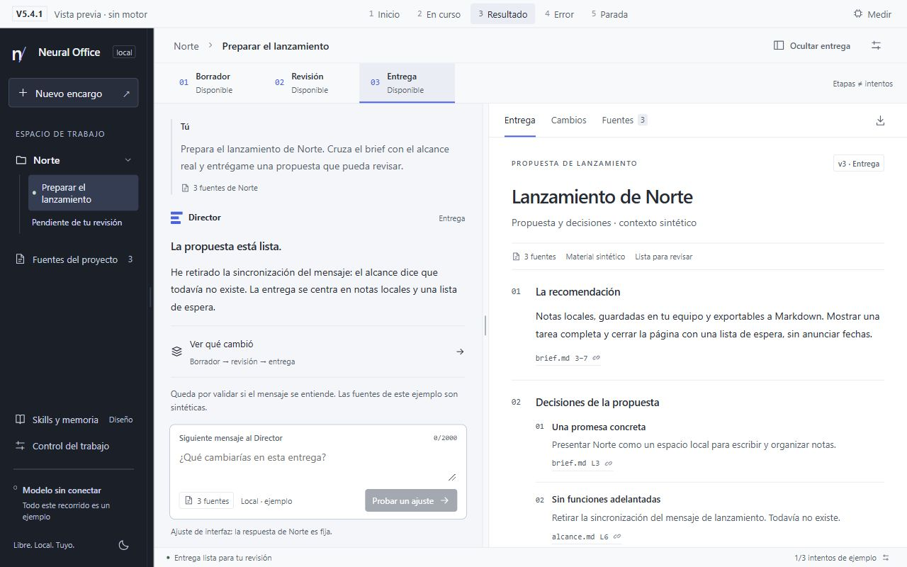
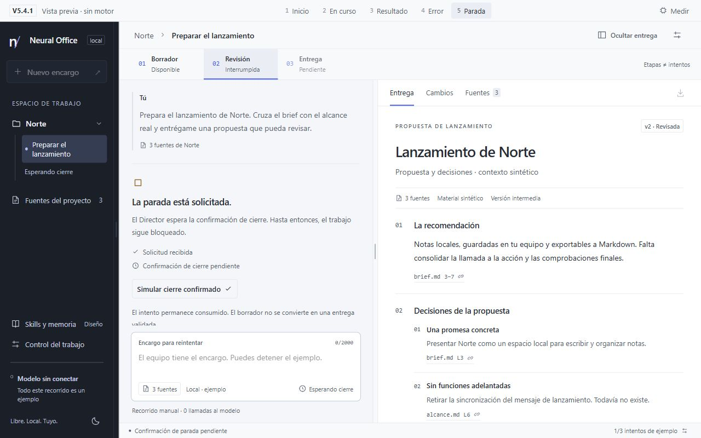

# V5.4.1 · Una mesa de trabajo que se deja revisar

Cinco escenas, un Director y una entrega con fuentes. Esta revisión mejora composición, estados y ajuste del espacio. **El motor sigue sin conectarse.** El contenido de Norte es sintético; escribir otro objetivo no genera otro resultado.

[Abrir el prototipo](../desktop/README.md) · [Recursos y límites](V5_4_1_RESOURCE_BASELINE.md) · [Registro de comprobaciones](evidence/V5_4_1_VERIFICATION.json)

## Las cinco pantallas

| Escena | Qué revisar |
| --- | --- |
| [Inicio](images/v5.4.1-ready.jpg) | Objetivo, fuentes y una única acción para comenzar |
| [En curso](images/v5.4.1-running.jpg) | Etapa actual, trabajo del equipo, parada y avance manual |
| [Resultado](images/v5.4.1-result.jpg) | Respuesta del Director, v1/v2/v3, cambios y siguiente mensaje vacío |
| [Error](images/v5.4.1-error.jpg) | Ausencia de resultado, encargo editable y un único reintento |
| [Parada](images/v5.4.1-stopping.jpg) | Confirmación pendiente antes del historial; ningún nuevo inicio hasta cerrar |

[Tema oscuro](images/v5.4.1-dark.jpg) · [Ventana estrecha](images/v5.4.1-mobile.jpg)

## Identidad y decisiones

**PROPUESTA DE DISEÑO:** una mesa de revisión con un interlocutor y su trabajo al lado. Navegación grafito, superficies neutras y acento azul para foco, versión y acción. La marca de tres trazos del Director se relaciona con el recorrido de tres etapas. Tipografía del sistema, documentos legibles y separación por líneas; sin tarjetas de métricas, ilustraciones de oficina o decoración animada.

El encabezado de la entrega ocupa menos espacio. Al terminar, la respuesta del Director precede al registro del equipo. Las etapas pendientes no repiten descripciones que aún no necesitan atención. Las fuentes y los cambios siguen vinculados al documento, en lugar de convertir todo el espacio en un chat.

**VERIFICADO EN ESTA PREVIEW:** el siguiente mensaje se vacía al enviar; una entrega no puede reenviarse con Ctrl+Enter sin texto nuevo. Error y parada confirmada recuperan el objetivo para reintentar. Navegación y conversación se ajustan con arrastre, flechas, Shift+flechas, Home/End y Enter para restablecer. Los anchos se conservan en la pestaña y se limitan al espacio disponible. En ventanas estrechas los paneles se apilan.

El patrón de separador sigue las propiedades de valor, nombre, orientación y control descritas por [WAI-ARIA APG](https://www.w3.org/WAI/ARIA/apg/patterns/windowsplitter/). **Diferencia deliberada:** Enter restablece el ancho, no colapsa el panel; la entrega tiene un botón explícito para ocultarse. No afirmamos conformidad completa con ese patrón ni certificación de accesibilidad.

## Qué aceptamos de la revisión externa

| Observación | Decisión y evidencia |
| --- | --- |
| Anchuras rígidas | Corregido con dos divisores, límites derivados del contenedor y controles de teclado: [PaneDivider.tsx](../desktop/src/workspace/PaneDivider.tsx#L7), [panes.ts](../desktop/src/workspace/panes.ts#L4) |
| Solo se veían dos versiones | Tres etapas manuales y dos comparaciones visibles. Son fixtures, no tres loops autónomos implementados: [model.ts](../desktop/src/workspace/model.ts#L21) |
| Actividad escondida | Registro corto visible; se despliega la información que corresponde a la etapa. Sin inventar tool calls, latencias, tokens o PIDs |
| Color y tipografía debían ser obligatoriamente oscuros y diminutos | No es una regla demostrada. Se conserva tema claro/oscuro y se comprueban contraste, lectura y anchuras; preferencia visual pendiente del usuario |
| Memoria y skills deberían estar activas | Fuera del alcance autorizado. La biblioteca declara su estado futuro; no se simula aprendizaje real |
| La tercera iteración debe reemplazar el contador de tres intentos | Rechazado: etapas, intentos y llamadas son magnitudes diferentes. La UI no altera el presupuesto del núcleo |
| Streaming, kill-switch y aislamiento inmediatos | Requieren transporte y pruebas del núcleo en V5.5. Ningún nuevo permiso ni conexión en V5.4.1 |

**DESCONOCIDO:** no se han corroborado las citas sociales, los rankings académicos ni el salto numérico de calidad propuesto por la revisión externa. No se presentan como entrevistas, consenso de usuarios ni resultados de investigación. Un listado de 75 repositorios no equivale a 75 inspecciones de código. Un ejemplo comprobable de confusión es [delta-io/delta](https://github.com/delta-io/delta): es Delta Lake, no un visor de diffs de terminal. Las recomendaciones se aceptan por evidencia aplicable, no por la autoridad atribuida a una cita.

## Qué tomamos de Dusk

Referencia fijada: [DuskBotAI/duskbot, efc77fd](https://github.com/DuskBotAI/duskbot/tree/efc77fd5c90adfb3a099d57e934f07b7a20268f6). La investigación anterior distinguió su demo, código y comportamiento no ejecutado. En esta entrega aprovechamos tres principios: conversación principal clara, atención contextual y detalle progresivo.

Su [ChatView](https://github.com/DuskBotAI/duskbot/blob/efc77fd5c90adfb3a099d57e934f07b7a20268f6/src/components/ChatView.tsx#L732-L768) limita la representación inicial y amplía por bloques; no justifica afirmar que cualquier historial está permanentemente virtualizado. Sus [pantallas diferidas](https://github.com/DuskBotAI/duskbot/blob/efc77fd5c90adfb3a099d57e934f07b7a20268f6/src/components/lazy-screens.tsx#L6-L61) tampoco prueban por sí solas un consumo menor en nuestro equipo.

La implementación de Neural Office es propia. No incorpora código, CSS, imágenes ni personajes de Dusk. Su [licencia](https://github.com/DuskBotAI/duskbot/blob/efc77fd5c90adfb3a099d57e934f07b7a20268f6/LICENSE#L1-L51) no debe confundirse con MIT. No presentamos nuestras fixtures como una alternativa funcional equivalente a su producto.

## Registro de caza de matices

Base inspeccionada: [d9a7fd7](https://github.com/ymkaddur/neural-office/tree/d9a7fd7b4757b77c8a83c38ab8502b89eced3c53). Las observaciones de navegador son manuales asistidas y quedan separadas de los tests automáticos.

### Incidente I1 · Reenvío del encargo terminado

**OBSERVADO — fase 0:** en Resultado de V5.4, Ctrl+Enter sin editar inicia el mismo objetivo y cambia el contador de 1/3 a 2/3. La propiedad esperada es que iniciar un ajuste requiera una nueva entrada explícita.

Escenarios, por poder discriminante:

1. **Confirmado:** `objective` y `draft` conservan el mismo texto. La fixture de resultado lo coloca en el compositor y `START` lo acepta: [base model.ts:10–17](https://github.com/ymkaddur/neural-office/blob/d9a7fd7b4757b77c8a83c38ab8502b89eced3c53/desktop/src/workspace/model.ts#L10-L17).
2. **Descartado como causa necesaria:** un resultado asíncrono atrasado. La reproducción usa una fixture directa de resultado y una sola acción START; no necesita un evento FINISH.
3. **Descartado como causa necesaria:** una escritura atrasada de almacenamiento o doble envío. La comparación pura de reductores, sin almacenamiento ni DOM, reproduce el incremento una sola vez en la base.

**VERIFICADO — experimento diferencial:** misma entrada sintética y START sobre una fixture de resultado: la base admite otro intento; V5.4.1 conserva el contador. En navegador, el compositor final está vacío, el botón está desactivado y Ctrl+Enter no cambia de etapa. Escribir un ajuste sí consume exactamente otro intento.

Intervención local: [model.ts:10–25](../desktop/src/workspace/model.ts#L10), con regresión en [model.test.ts](../desktop/src/workspace/model.test.ts#L47). Error y cancelación confirmada conservan la posibilidad explícita de reintentar; no se reembolsa cuota.

### Incidente I2 · Navegación móvil bloquea el escritorio

**OBSERVADO:** abrir navegación en ventana estrecha → ensanchar → navegación visible en escritorio, cierre móvil oculto y `.office-workspace` todavía `inert`. Un problema de contraste no explica que el árbol accesible excluya el área de trabajo.

**VERIFICADO:** `navOpen` sobrevivía al cambio de media query. La misma secuencia después del cambio deja `inert=false` y devuelve el foco al trabajo. [Workspace.tsx:71–97](../desktop/src/workspace/Workspace.tsx#L71). Al ocultarse un divisor por el cambio de anchura, el foco también vuelve a una superficie visible.

### Incidente I3 · La parada pierde prioridad visual

**OBSERVADO:** en la primera pasada de capturas, la acción de confirmar cierre estaba después del historial y fuera de la porción visible. El estado inferior decía «pendiente», pero la siguiente acción quedaba desplazada.

**VERIFICADO:** se coloca la interrupción antes de la actividad. [Workspace.tsx:179](../desktop/src/workspace/Workspace.tsx#L179) y [captura Parada](images/v5.4.1-stopping.jpg). No cambia la semántica del cierre; sigue siendo confirmación manual de una fixture.

### Incidente I4 · Trabajo repetido durante el arrastre

**OBSERVADO POR INSPECCIÓN:** el primer divisor evaluaba `readPane(...)` como argumento de `useRef` en cada render. Eso podía repetir una lectura síncrona de almacenamiento por actualización.

**VERIFICADO EN CÓDIGO:** inicialización perezosa con `useState`; el valor deseado queda en un ref. El divisor actualiza su propio estado y una propiedad CSS, no el árbol de conversación. Como máximo hay un frame pendiente; se cancela al desmontar. Persistencia al terminar el gesto, no en cada movimiento. [PaneDivider.tsx:7–69](../desktop/src/workspace/PaneDivider.tsx#L7).

**LÍMITE:** no se atribuye a este cambio una mejora de CPU medida. Escape, pérdida de captura y pérdida de foco tienen rutas de cancelación; faltan ensayos con hardware táctil real.

### Incidente I5 · El compositor sale de la ventana estrecha

**OBSERVADO:** a 392 × 844 píxeles CSS, el compositor del resultado terminaba en y=1204; el apilado había convertido toda la conversación en contenido sin límite de altura. En ejecución, eso también desplazaba la parada fuera de la vista inicial.

**VERIFICADO:** la conversación tiene ahora desplazamiento propio dentro de la primera superficie; el compositor termina en y=816. La parada móvil se ofrece en la cabecera y se comprobó la transición al pulsarla. [workspace.css:385](../desktop/src/workspace/workspace.css#L385). Las 35 combinaciones de cinco escenas y siete anchuras mantuvieron el compositor dentro de la ventana y no presentaron desbordamiento horizontal en las superficies comprobadas. Son mediciones DOM; las capturas revisadas corresponden a 1280 × 800 y 520 × 844.

## Tres pases de revisión

1. **Comportamiento:** reenvío vacío, doble inicio, revisiones atrasadas, etapas duplicadas, error, parada y agotamiento. 18 pruebas Node, incluidos 12.000 pasos de secuencias deterministas de acciones; no son una prueba exhaustiva de todos los interleavings.
2. **Visual y acceso:** cinco escenas, dos temas, fuentes, versiones, foco, teclado, divisores, anchuras de escritorio y móviles. Se corrigieron el bloqueo responsive y la prioridad de la parada. Registro de tamaños CSS reales en el JSON.
3. **Recursos y publicación:** build de producción, dependencias sin cambios, muestras acotadas, revisión del diff y de archivos publicables. Nada del motor, modelos, PDF privado, credenciales o estado personal entra en esta entrega.

## Duda residual, siguiente paso y confianza

**DESCONOCIDO:** aceptación por usuarios, uso con lector de pantalla, IME real, captura táctil y consumo del escritorio empaquetado. Las escenas no persisten ejecuciones; recargar o cambiar de escena carga otra fixture. El compositor de ajustes no conserva un historial real.

**Siguiente acción:** revisar visualmente estas cinco pantallas y el comportamiento de los divisores. G-UI permanece abierto hasta la aceptación y las pruebas formativas. Solo después corresponde conectar eventos y autoridad reales en V5.5.

**Confianza de ingeniería: 90 % en las correcciones reproducidas dentro de esta preview.** Es una valoración, no una probabilidad estadística ni certificación de ausencia total de errores. La asunción crítica es que el comportamiento con fixtures no se extrapola al futuro transporte o al modelo.
