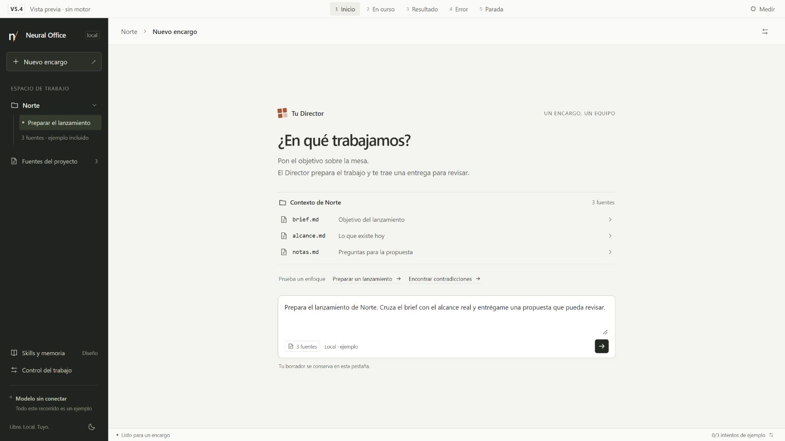
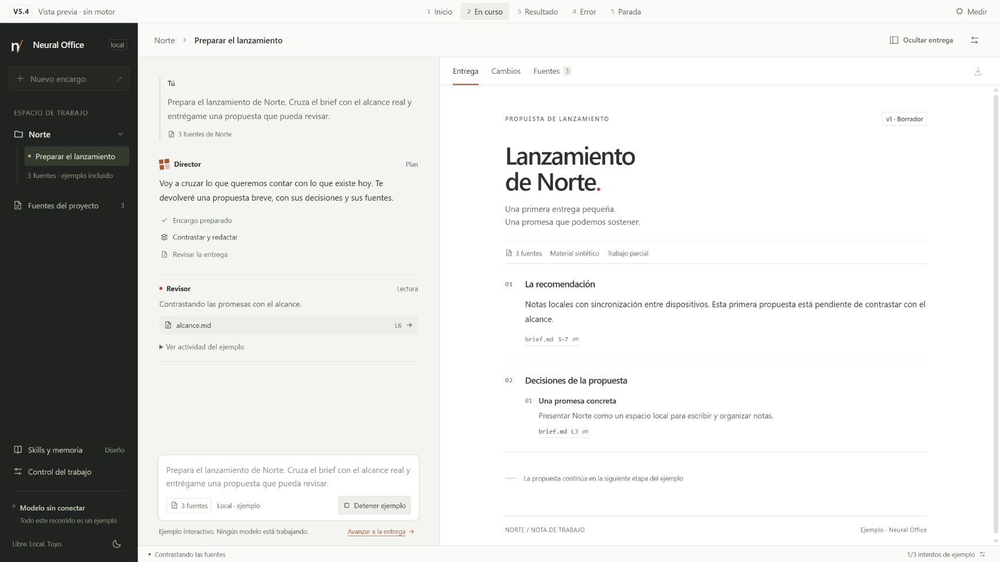
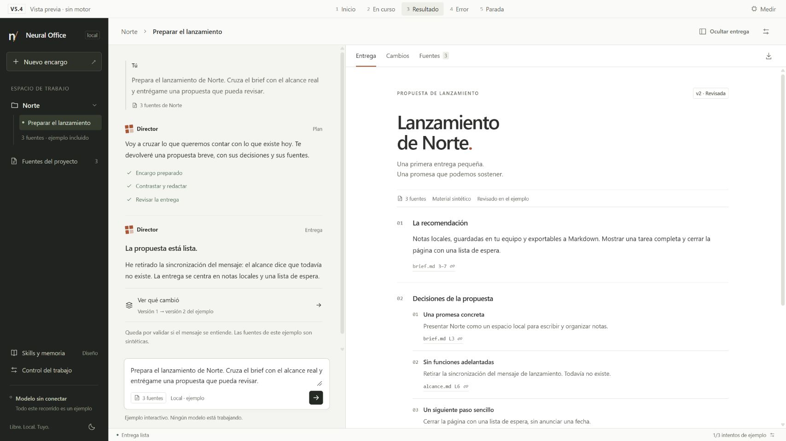
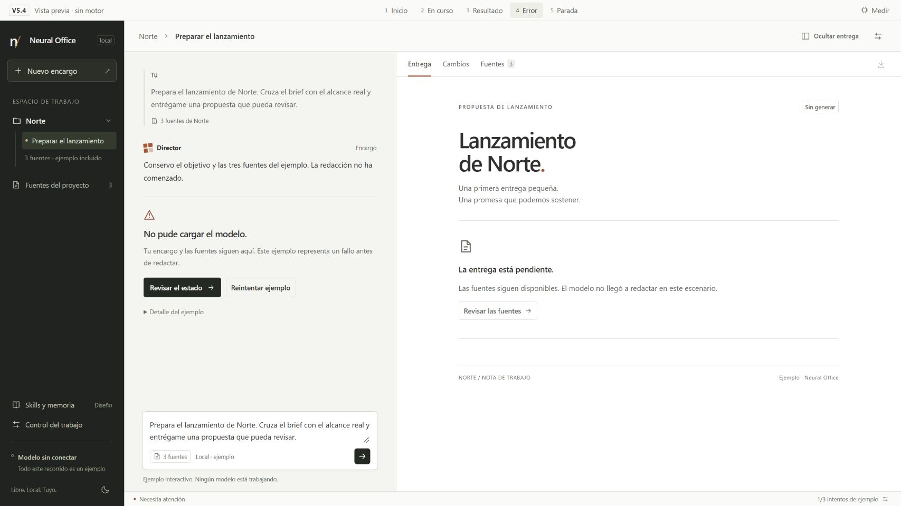
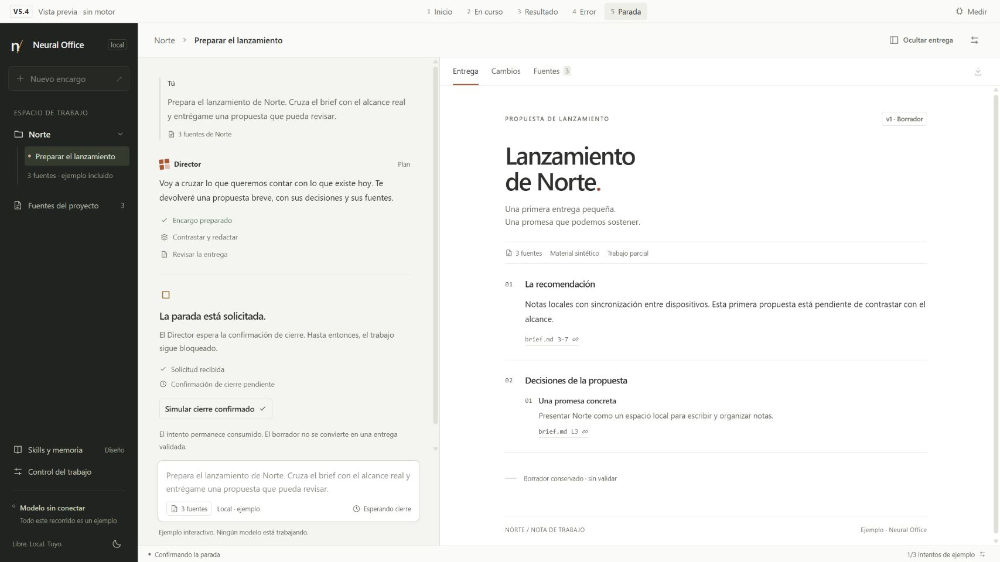
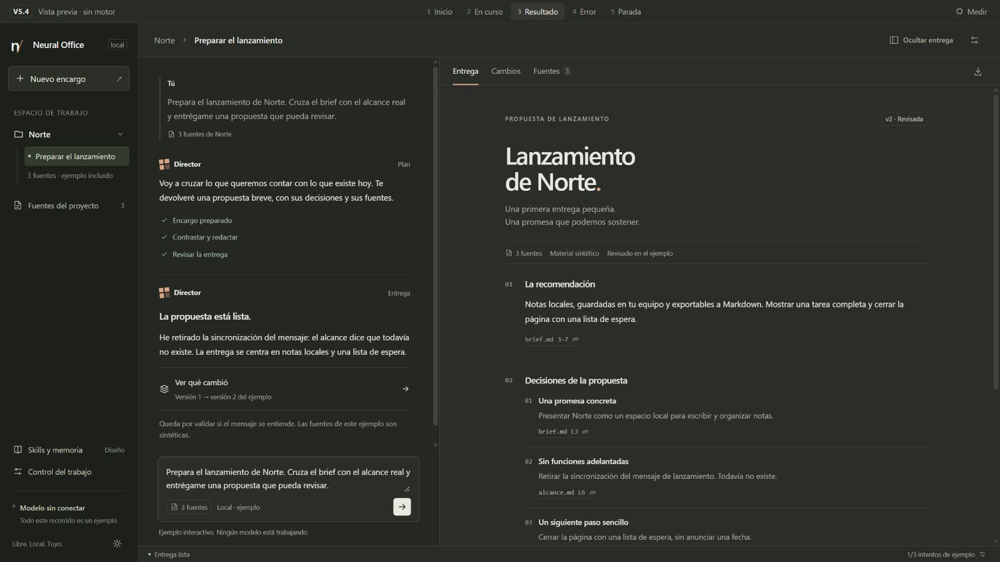

# V5.4 · Cinco pantallas para revisar

**Vista previa interactiva, 16 de noviembre de 2026. La dirección visual está pendiente de aceptación.** El motor operativo conserva V5.3 y no se conecta a estas pantallas. [Abrir el prototipo](../desktop/README.md) · [Decisiones de diseño](V5_4_DESIGN.md) · [Recursos medidos](V5_4_RESOURCE_BASELINE.md).

La propuesta es una mesa de trabajo: navegación discreta, conversación con el Director y una entrega legible. Se eliminan la cuadrícula de indicadores, las tarjetas de empleados y el formulario de auditoría como centro de la aplicación. El caso ficticio «Norte» permite revisar un encargo documental; **no incorpora todavía esa capacidad al motor**.

## 1. Antes de empezar

Ruta `?screen=ready`. El objetivo se escribe en el compositor y las tres fuentes se pueden abrir. El modelo aparece como **sin conectar**. «Preparar un lanzamiento» y «Encontrar contradicciones» rellenan el borrador. Ctrl+Enter inicia el recorrido de ejemplo. El resultado sigue siendo una fixture de Norte aunque cambies el objetivo: no hay generación personalizada.

## 2. Trabajo en curso

Ruta `?screen=running`. Conversación a la izquierda y borrador a la derecha. La actividad del revisor abre la línea concreta de la fuente. «Detener ejemplo» solicita la parada; «Avanzar a la entrega» hace avanzar manualmente la fixture. No hay temporizadores fingiendo trabajo del modelo, porcentajes inventados ni razonamiento interno expuesto.

La v1 incluye deliberadamente una promesa de sincronización incompatible con `alcance.md:6`. Se muestra como borrador pendiente de contrastar. La v2 y su diff eliminan esa misma frase; la comparación no debe inventar una edición ausente del borrador.

## 3. Resultado revisable

Ruta `?screen=result`. La entrega ocupa la superficie principal. Las pestañas **Entrega / Cambios / Fuentes** permiten revisar el contenido, comparar v1→v2 y abrir fuentes numeradas. Las flechas, Home y End funcionan en las pestañas. Exportar descarga Markdown sintético, identificado como ejemplo sin inferencia.

«Revisada» describe el guion del prototipo; no certifica una revisión ejecutada por agentes. El interés del público y la comprensión del mensaje se presentan como pendientes, sin testimonios inventados.

## 4. Error sin éxito aparente

Ruta `?screen=error`. El escenario `MODEL_UNAVAILABLE_DEMO` conserva el encargo y las fuentes, muestra que no se generó una entrega y permite revisar el estado o reintentar. Reintentar consume otro intento simulado. No aparecen pasos de redacción completados. Este escenario **no reproduce ni resuelve R13**, el timeout histórico del backend.

## 5. Parada pendiente

Ruta `?screen=stopping`. Solicitud y confirmación son estados distintos. Mientras falta confirmación no se admite otro trabajo. «Simular cierre confirmado» desbloquea el recorrido sin devolver el intento y sin convertir el borrador en entrega exportable. La UI futura deberá recibir esa confirmación del núcleo, nunca de un temporizador visual.

## Tema y ventana estrecha

Se conservan tema claro y oscuro. A 391 × 844 CSS px se verificaron compositor accesible, ausencia de desbordamiento horizontal y navegación con teclado. La navegación móvil devuelve el foco al abrir/cerrar; un diálogo de fuentes se cierra antes que la navegación que lo abrió. En anchuras pequeñas conversación y entrega se apilan. No se ha certificado toda la interfaz con lector de pantalla ni todos los tamaños de texto.

## Diario de revisión crítica

**Incidente de partida — OBSERVADO:** el propietario rechaza V5.3 y los dos prototipos posteriores; la propiedad esperada es una dirección visual comprensible y aceptable antes de integrar. No hay evidencia para atribuir ese rechazo a una causa única ni al mercado entero.

| Hallazgo | Corrección / evidencia | Límite |
| --- | --- | --- |
| La primera propuesta V5.4 reducía demasiado la tipografía | Texto de trabajo ampliado; se conserva jerarquía mediante composición y líneas | La preferencia y comodidad de lectura las debe validar una persona |
| Contraste mínimo de texto muestreado de 4,08:1 en claro | Se oscureció el token de texto secundario; nueva muestra ≥4,89:1 en claro y ≥4,92:1 en oscuro | Inspección de texto visible con fondo sólido; no certificación WCAG ni de todos los estados |
| Cambiar de fuente dentro del diálogo perdía el punto de retorno del foco | Se guarda el disparador solo al abrir; fuente distinta → cerrar → foco en la cita original, comprobado | Prueba manual en el navegador utilizado |
| Escape cerraba primero la navegación móvil y dejaba el diálogo abierto | El manejador de navegación deja actuar al diálogo nativo cuando está abierto; repetición verificada | No se extrapola a todos los lectores de pantalla |
| Una clase derivada de «no terminado» podía sugerir actividad en error/parada | Redacción activa solo en `running`; el error no muestra el plan como ejecutado | Estados de fixture, no eventos del núcleo |
| El diff inicial no tenía una frase equivalente en el borrador mostrado | Se alinearon v1, v2, diff y exportación | No es un editor ni un diff calculado de documentos arbitrarios |
| El indicador superior podía quedarse en la escena inicial tras una transición | Selección basada en el estado actual | Las rutas de galería cargan fixtures nuevas |

**VERIFICADO:** doce pruebas de estado del frontend (siete conservadas y cinco nuevas), comprobación de tipos y build; 125 pruebas Python sin cambiar el núcleo. Interacciones de fuentes, diff, exportación, cuota tras fallo/parada y foco comprobadas en navegador. [Registro de UI](evidence/V5_4_UI.json) · [Build y aislamiento](evidence/V5_4_BUILD.json).

**ESCENARIO de diseño:** Director + documento + fuentes bajo demanda puede resultar más claro que el tablero anterior. Su poder discriminante es limitado porque también cambia el caso de uso y la composición. No se declara superioridad frente a Claude, OpenCode, T3 ni Hermes por una captura o una puntuación inventada.

## Lo que todavía no me satisface

1. **La nueva estética no está validada.** Puede seguir pareciendo demasiado editorial o demasiado parecida a herramientas existentes. La prueba útil consiste en encargar, identificar el estado, abrir una fuente y detener, sin explicación del desarrollador.
2. **Los paneles aún no son redimensionables.** Se puede ocultar la entrega y existe disposición estrecha, pero falta ajustar el ancho con ratón y teclado y recordar la preferencia. Debe resolverse antes de dar por cerrado G-UI.
3. **Solo hay un proyecto y una tarea de ejemplo.** No se han probado títulos extensos, 50 sesiones reales, artefactos grandes ni uso diario. Cambiar el dominio de HTML a documentos mejora la ilustración de la visión, no la capacidad del producto.
4. **Las métricas son una línea base parcial.** Heap web y bundle no acreditan RAM total, CPU en reposo durante diez minutos, p95 de interacción ni ausencia de fugas. Tampoco hay medición del futuro host Tauri.
5. **El componente de composición sigue concentrado.** Antes del transporte real conviene separar navegación, compositor, documento e inspectores, conservando sus contratos y pruebas; no trasladar todo este estado de fixture al núcleo.
6. **Accesibilidad y controles aún necesitan sesiones formativas.** Contraste muestreado y teclado no sustituyen lector de pantalla, zoom, textos largos y pruebas con personas. Los botones compactos deben revisarse también con interacción táctil.

**Duda residual principal:** ¿esta composición permite entender y revisar el trabajo con menos esfuerzo, o solo ha cambiado la apariencia? Confianza alta en los recorridos concretos observados; confianza todavía no establecida en la aceptación visual y la usabilidad general. No se ofrece un porcentaje de éxito de producto sin datos.

**Siguiente acción:** revisar estas cinco pantallas y cerrar una lista acotada de cambios visuales; después, paneles ajustables y prueba formativa. La conexión con el motor pertenece a V5.5 y queda supeditada a esa aceptación. V5.4 se publica como progreso revisable, no como versión funcional terminada.
