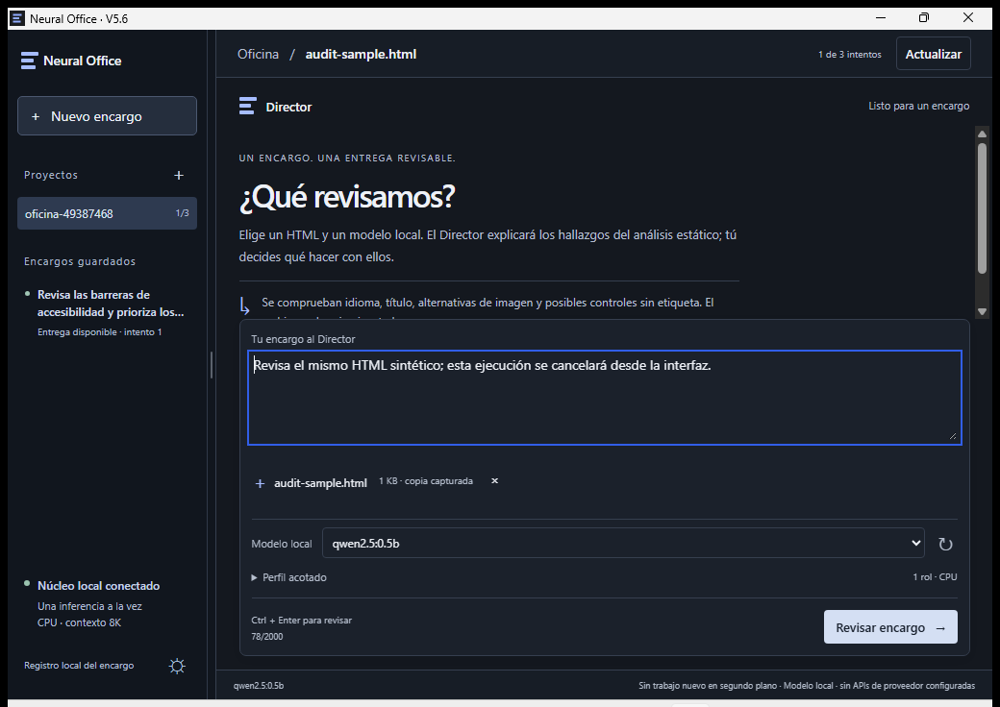

# V5.6 · una entrada clara y una entrega útil

Base de revisión: `d8aa4e6c9529ae220b64c4903e61500ea02475fb`. Alcance: presentación pública, navegación del escritorio y análisis HTML de lectura. Las pruebas usan datos sintéticos; no se incluyen conversaciones, auditorías privadas ni estado personal.

## Registro de investigación

**Problema:** al consultar un historial o cambiar de proyecto, la interfaz podía perder un borrador; durante el arranque podía representar un intento con el proyecto equivocado. Una revisión del analizador encontró además dos omisiones causadas por la misma condición de tipo.

| Caso y etiqueta | Predicción / experimento | Observación y corrección |
|---|---|---|
| **VERIFICADO · navegación destructiva** | Escribir A, abrir B y volver; abrir historial y regresar. | La base borraba texto/fuente mediante `newTask`. Se conserva un borrador por proyecto en memoria de esta ventana; leer no descarta. |
| **VERIFICADO · arranque tardío** | Retener el primer `attempt.get` de A e intentar seleccionar B. | La base permitía mostrar cuota B junto al intento A. Se bloquea interacción mutadora durante la conciliación inicial. |
| **VERIFICADO · arranque fallido, contraprueba** | Rechazar ese detalle y pulsar Actualizar. | El primer candidato liberaba la UI sin conservar A. La corrección publica primero el intento canónico del snapshot, conserva su identidad si falla el detalle y permite reconsultarlo. |
| **VERIFICADO · respuesta de envío perdida** | Guardar borrador, perder ACK y consultar la misma clave. | El primer candidato retenía un borrador ya enviado. Sólo un recibo coincidente confirmado lo elimina; una consulta sin reserva conserva el texto. No se repite `attempt.start`. |
| **VERIFICADO · exclusión HTML incorrecta** | Añadir/quitar sólo `type` a un `select` o `textarea` sin etiqueta. | La exclusión de tipos de `input` suprimía ambos candidatos. Se limita la condición al elemento `input`. |
| **VERIFICADO · galería en producción** | Compilar `main.tsx` y abrir `screen` / `preview` con host sintético. | La base podía abrir fixtures en vez del espacio conectado. Ahora exige modo de desarrollo y `preview=1`; la compilación de producción excluye sus escenas. |
| **VERIFICADO · exceso de explicación visible** | Ejecutable candidato en cliente 1024×697, cuatro hallazgos y recomendaciones desplegadas. | La primera corrida nativa falló: el cuarto hallazgo quedaba fuera del área visible. La contraprueba conserva ese tamaño y muestra los cuatro al compactar el resumen y desplegar orientación bajo demanda. El ensayo nativo ampliado también abre/cierra la orientación sin ejecutar trabajo. |

Fuentes de la base: [navegación y arranque](https://github.com/ymkaddur/neural-office/blob/d8aa4e6c9529ae220b64c4903e61500ea02475fb/desktop/src/connected/ConnectedWorkspace.tsx#L114), [borrado del borrador](https://github.com/ymkaddur/neural-office/blob/d8aa4e6c9529ae220b64c4903e61500ea02475fb/desktop/src/connected/ConnectedWorkspace.tsx#L234), [condición HTML](https://github.com/ymkaddur/neural-office/blob/d8aa4e6c9529ae220b64c4903e61500ea02475fb/neural_office/audit.py#L34), [ruta de galería](https://github.com/ymkaddur/neural-office/blob/d8aa4e6c9529ae220b64c4903e61500ea02475fb/desktop/src/main.tsx#L6).

## Cambios para quien usa el producto

- README con un recorrido principal, documentación de uso separada del historial y apoyo voluntario al pie.
- Comando `check` para obtener hallazgos sin modelo ni estado. Conserva la captura restringida existente.
- Informe con ubicación, alcance y siguiente acción desplegable por hallazgo. Los comentarios del modelo conservan su condición de sugerencias.
- **Volver al borrador** al consultar el historial. Fuente y texto no se escriben en un nuevo almacén persistente; cerrar esta ventana descarta los borradores no enviados. El caché tiene un máximo de veinte y rechaza navegación que exigiría expulsar trabajo; permite vaciar texto y quitar fuente explícitamente.
- Las aprobaciones no se guardan con el borrador. Cada regreso requiere revisar de nuevo; una capacidad de fuente caducada exige volver a seleccionarla.
- Informes nuevos `static-html-checks-v2`; lectura compatible con v1. Se conservan informes y recibos anteriores.

El ledger, cuotas, permisos IPC, propiedad de procesos, esquema de base de datos, dependencias y política de inferencias no se reestructuran. La compilación conserva el mismo límite de confianza. Job Objects controla procesos propios; no aísla disco o red.

## Evaluación separada de la implementación

El [corpus](../examples/html-review-corpus.json) tiene **18 contratos y dos sondas semánticas**. Antes: 16/18 contratos; después: 18/18. Ambas sondas mantienen omisiones y se informan como **0/2**, no como aciertos. [Ejecutar el evaluador](../tools/evaluate_v56_html.py) y [entender su alcance](HTML_REVIEW.md).

El oráculo literal fue redactado por un revisor que conocía el código, antes de la comparación. Es mejor que comparar una función consigo misma, pero no una evaluación ciega ni evidencia de utilidad con clientes. No se ha probado que uno, tres o siete roles mejoren esta referencia sin modelo.

## Verificación reproducible

```powershell
py -3.12 -B -m unittest discover -s tests -v
py -3.12 -B tools/evaluate_v56_html.py
Set-Location desktop
npm ci --ignore-scripts
npm test
npm run build -- --mode native
```

Las regresiones React ejecutan el componente real con DOM/RPC sintéticos; no son pruebas nativas ni de lector de pantalla. El [recorrido UI Automation](../tests/e2e_v55_native_uia.py) añade historial → retorno exacto al borrador y fuente → aprobación, comprobando que leer no cree intentos ni llamadas. Conserva selección nativa, modelo real, informe, cierre/reapertura y cancelación del recorrido anterior.

**VERIFICADO, 17 de noviembre de 2026:** [CI 44085924979](https://github.com/ymkaddur/neural-office/actions/runs/44085924979) completó **199 pruebas Python, 46 Node, seis Rust y diez comprobaciones nativas**. Código de rama `c200eef76197c444c063b8262535db5a83bb20bd`; merge de prueba `d5e681a83b877d48898b2d9d9fd05ecfdd7b6df4`. Se conservan [resultados, revisiones y hashes](evidence/V5_6_VERIFICATION.json) y [evidencia nativa](evidence/V5_6_NATIVE.json). Los commits posteriores de documentación no cambian ese código de ejecución o prueba.

El recorrido utilizó `qwen2.5:0.5b`, un HTML sintético y una llamada real. La entrega tardó 11,437 s en ese runner; es una observación de integración, no un benchmark de calidad. Reabrir, desplegar orientación y recuperar el borrador no añadieron reservas ni llamadas. El segundo intento se canceló antes de una segunda llamada: este recorrido no demuestra cancelación durante generación.

Se mantienen dos fallos anteriores en el registro: el primero detectó el cuarto hallazgo fuera de la vista; el segundo confirmó la corrección visual, pero el instrumento intentó `Invoke` sobre un `summary` sin ese patrón UIA. Se sustituyó sólo esa acción de test por entrada real de puntero, conservando las postcondiciones. No se eliminaron aserciones ni se repitió una ejecución idéntica hasta obtener verde.



Captura original de CI con datos sintéticos. No representa persistencia del borrador al cerrar la ventana.

## Recursos y publicación

**OBSERVADO:** assets de producción de 349.511 a 310.171 bytes en compilaciones comparables: **11,26 % menos bytes distribuidos**. Se excluye la escena histórica, que antes se cargaba de forma diferida; esto no demuestra ahorro de RAM al abrir la aplicación.

El muestreo del ejecutable contiene 61 observaciones durante 30,797 s. Picos muestreados por fase:

| Fase | Suma RSS, MiB | Memoria privada comprometida, MiB |
|---|---:|---:|
| Reposo inicial | 381,953 | 134,914 |
| Primera ejecución | 1.012,555 | 872,633 |
| Reposo posterior | 428,953 | 153,715 |

La suma RSS puede contar páginas compartidas varias veces. Los contadores CPU registrados sólo suman procesos presentes en cada observación; no representan el CPU total de toda su vida. Se excluyen el servidor de metadatos del test y su instrumentación. No hay medición GPU, sesión prolongada ni prueba de mejora de memoria; V5.8 exige esas comparaciones antes de prometer optimización.

Los ZIP descargados, el ejecutable y 433 hashes de avisos/licencia coinciden con sus manifiestos. Las capturas publicadas son bytes originales del artefacto y muestran sólo el caso sintético. La revisión de privacidad aplica patrones, revisión visual y comprobación de autoría a la nueva entrega; no certifica la desaparición de objetos históricos o cachés externos. Los PDF y el estado personal quedan fuera del repositorio.

## Revisión crítica de las recomendaciones externas

**OBSERVADO:** las revisiones externas recibidas declaran V5.4.1/núcleo 5.3.1. Su crítica a las maquetas y a una portada excesivamente técnica sirve como señal de diseño; su premisa de desconexión no describe la integración V5.5 ya ejecutada. No aportan sesiones de usuarios para demostrar abandono en diez segundos ni superioridad de una tipografía universal.

**DECISIÓN:** adoptar claridad, contenido real, menor confusión de versiones y pasos útiles. No adoptar promesas de cero fugas, convergencia garantizada, un GIF de Git que el producto no ejecuta ni la equiparación Job Objects/sandbox. Mostrar trazas, entradas y decisiones comprobables no exige presentar razonamiento interno como una prueba de corrección. Fuente monoespaciada, terminal, árbol Git y streaming son decisiones por tarea, no certificados de calidad.

## Duda residual y siguiente paso

**DESCONOCIDO:** utilidad adicional de los comentarios, aceptación visual con personas, comportamiento prolongado y otros equipos. Siguen abiertos R13 (arranque intermitente de Ollama), las dos sondas de nombre accesible y la distribución firmada. No se declara ausencia total de errores ni se inventa una cuota de vulnerabilidades graves.

**Siguiente acción:** ejecutar V5.7 con tareas y rúbrica congeladas, comparar referencia sin modelo/un rol/revisión acotada y realizar una prueba formativa de uso. La [hoja de ruta vigente](../ROADMAP.md) condiciona el resto a esas pruebas.

Confianza subjetiva en las cadenas reproducidas: 95/100; no es probabilidad de que el producto esté libre de defectos. El supuesto crítico es que las fronteras sintéticas representan los eventos del renderer; el ensayo nativo y las comprobaciones de estado complementan, sin universalizar, esa evidencia.

La skill `neural-office-evidence-review` incorpora la lección de visibilidad: distinguir contenido existente, área de scroll y pantalla efectiva; retener el fallo y no relajar una aserción para obtener éxito. Su validación estructural no acredita comportamiento humano ni aprendizaje del runtime.
